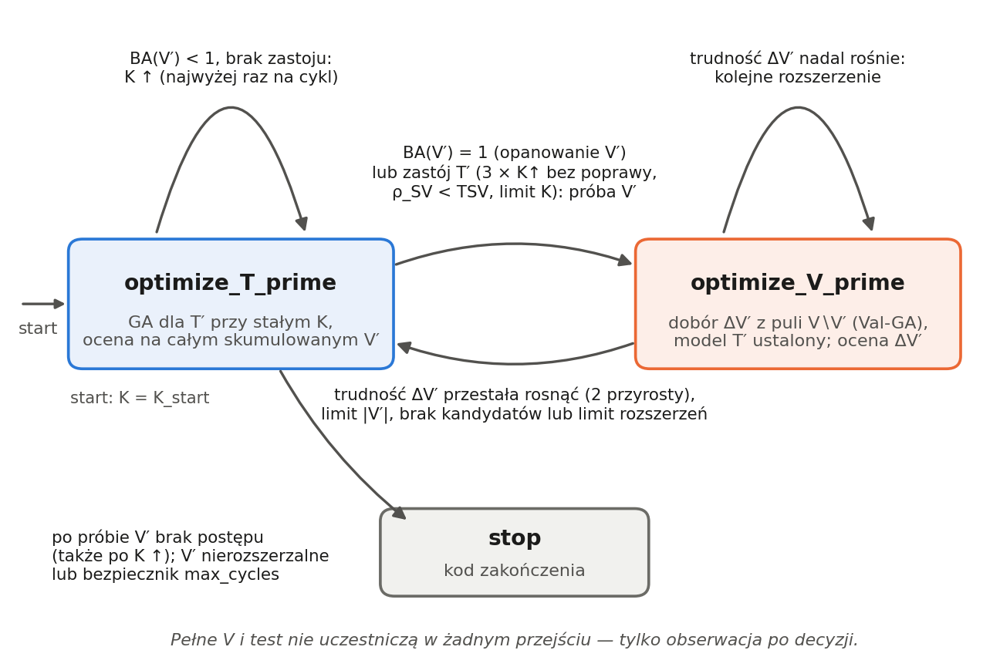
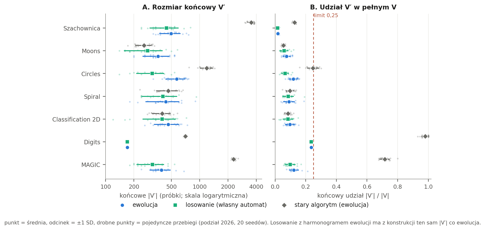
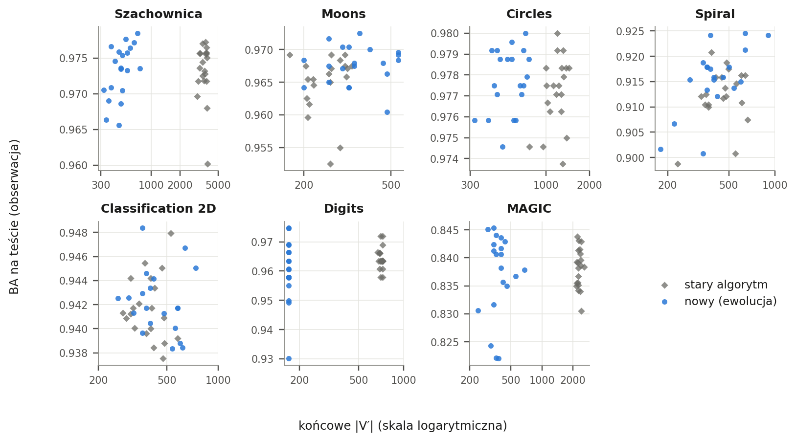
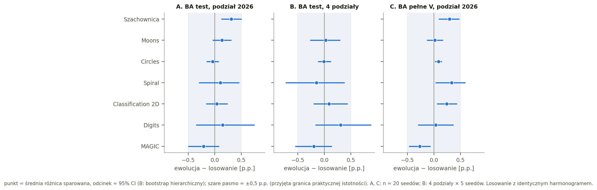
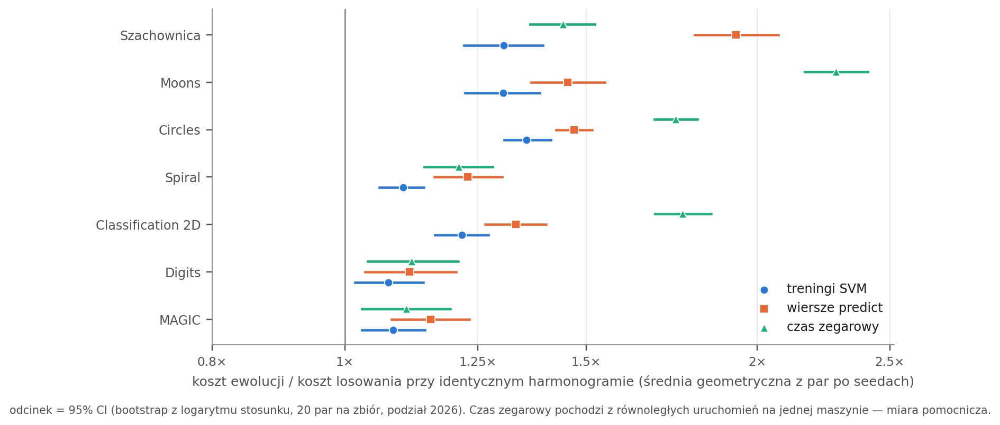
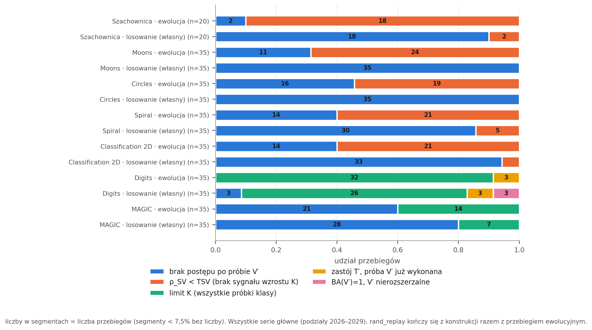
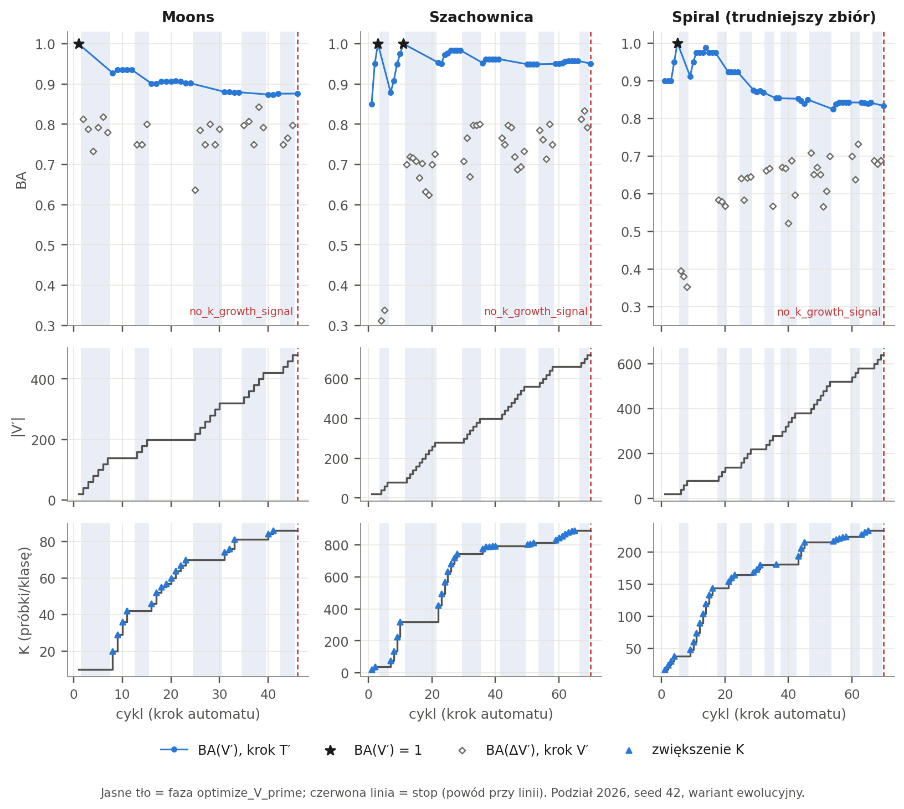
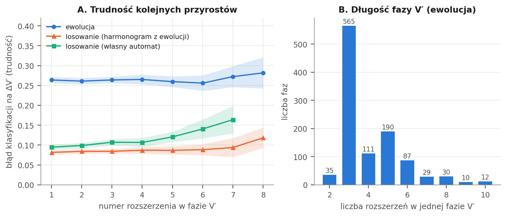

# DAGASVM: naprzemienna optymalizacja T′ ↔ V′ i dobór podzbioru walidacyjnego V′

*Badanie uzupełniające followup_phase_switch (wersja v2) — ewolucyjny a losowy dobór V′, rozmiar V′, przełączanie faz, koszt*


## 1. Streszczenie

> **Co zmieniono i dlaczego.** Poprzednia wersja DAGASVM rozszerzała V′ w rytmie wyznaczanym przez wzrost K i sygnał ρ_SV (przyrost = K_next − K), a osiągnięcie BA(V′) = 1,0 kończyło przebieg albo — po zmianie reguły — wymuszało minimalny rozmiar V′ i ponowne sprawdzenie. W efekcie V′ rosło na Szachownicy średnio do 3 528 próbek. Zgodnie z uwagami promotora wprowadzono jawny automat dwóch faz: optymalizacji T′ (GA przy stałym K, ocena na całym skumulowanym V′) i optymalizacji V′ (dobór nowych próbek ΔV′ z puli V \ V′ przy ustalonym modelu). BA(V′) = 1,0 przełącza do fazy V′ i nie kończy algorytmu; rozmiar V′ ma jawne limity; koniec następuje po braku postępu.
> **Co wykonano.** 690 przebiegów głównych (7 zbiorów, 3 warianty doboru V′: ewolucja, losowanie z harmonogramem ewolucji i losowanie z własnym automatem; podział bazowy: 20 seedów, trzy podziały dodatkowe: 5 seedów) oraz 21 przebiegów pilotażowych; wszystkie ukończone, bez błędów.
> **Co wykazano.** (1) Implementacja spełnia 11 z 12 wymagań z uwag promotora w pełni lub z zastrzeżeniem, a jedno (najpierw zwiększać K) częściowo: w 144 przypadkach faza V′ zaczyna się z powodu bramki ρ_SV bez zwiększenia K. (2) V′ przestało rosnąć do nadmiernych rozmiarów: Szachownica 498 ± 121 próbek (1,8% V) wobec 3 528 (12,7%), przy BA na teście bez różnicy (0,0000); maks. |V′|/|V| w całej serii = 0,236. (3) Ewolucja wybiera istotnie trudniejsze próbki (błąd modelu na ΔV′ wyższy o 0,11–0,24 na wszystkich 7 zbiorach), ale **nie wykazano praktycznie istotnej przewagi jakościowej ewolucji nad losowaniem**: różnice BA na teście mieszczą się w [−0,21; 0,31] p.p., CI wyklucza zero tylko na Szachownicy (+0,31 p.p., poniżej przyjętej granicy 0,5 p.p.). (4) Ewolucja kosztuje więcej: 1,08–1,36× treningów SVM i 1,12–1,93× wierszy predict niż losowanie przy tym samym harmonogramie.
> **Najważniejszy problem, który pozostał.** Rozmiar V′ i moment zakończenia wynikają głównie z reguł automatu (długość fazy V′ ≈ 3 rozszerzenia, liczba zastojów T′, bramka ρ_SV), a nie z sygnału jakościowego: w wariancie ewolucyjnym tylko 17% wejść do fazy V′ pochodzi z BA(V′) = 1, a 90% takich przypadków to V′ startowe (20 próbek). Trudność ΔV′ nie rośnie z kolejnymi rozszerzeniami, więc warunek „jakość nowych próbek przestała się pogarszać” jest spełniany niemal od razu i działa jak stała długość fazy.


## 2. Cel badania i pytania badawcze

Celem jest sprawdzenie, czy przebudowany algorytm DAGASVM — z naprzemienną optymalizacją podzbioru treningowego T′ i podzbioru walidacyjnego V′ — realizuje założenia promotora oraz czy ewolucyjny dobór V′ daje korzyść względem doboru losowego. Raport opisuje wyłącznie wykonane eksperymenty. Trudniejsze V′ i lepszy model są osobnymi właściwościami i są analizowane oddzielnie.

- **P0.** Czy implementacja spełnia 12 wymagań z uwag promotora (sekcja 5.1)?
- **P1.** Czy ewolucja wybiera trudniejsze próbki do ΔV′ niż losowanie (sekcja 5.3)?
- **P2.** Czy ewolucyjny dobór V′ prowadzi do lepszego modelu niż losowy, przy tym samym rozmiarze V′ (sekcja 5.4)?
- **P3.** Czy ewolucja jest warta dodatkowego kosztu obliczeniowego (sekcja 5.5)?
- **P4.** Czy V′ przestało rosnąć do nadmiernych rozmiarów i czy rozmiar V′ wpływa na jakość (sekcja 5.2)?
- **P5.** Jak działają warunki przełączania faz i zakończenia (sekcje 6 i 7)?


## 3. Opis algorytmu

Oznaczenia: V — pełny zbiór walidacyjny; V′ ⊂ V — skumulowany podzbiór walidacyjny sterujący algorytmem; ΔV′ — przyrost dodany w bieżącym rozszerzeniu (V′ ← V′ ∪ ΔV′); T′ — podzbiór treningowy (K próbek na klasę wybranych z pełnego zbioru treningowego); K — liczba próbek na klasę w T′; ρ_SV — udział wektorów podpierających w T′ po treningu SVM; TSV — próg ρ_SV (0,25). Jeden *cykl* to jeden krok automatu: jedno uruchomienie GA dla T′ albo jedno rozszerzenie V′.


### 3.1 Faza optimize_T_prime

GA (populacja 30, do 30 generacji) wybiera T′ o zadanym K z pełnego zbioru treningowego; fitness osobnika = metryka (domyślnie balanced accuracy) SVM wytrenowanego na T′, policzona na całym skumulowanym V′. Kolejna optymalizacja startuje z poprzednim najlepszym T′ w populacji (warm start), więc wynik przy tym samym K nie pogarsza się. GA kończy się wcześnie po 3 generacjach bez poprawy o ≥ 0,0005 albo po osiągnięciu BA(V′) = 1,0. Po GA liczone są: BA(V′) najlepszego T′, ρ_SV i kandydat na kolejne K.


### 3.2 Faza optimize_V_prime

Model T′ jest ustalony na czas fazy. Dobór ΔV′ odbywa się wyłącznie z puli kandydatów V \ V′ (stare próbki V′ nie są oceniane ponownie). Wariant ewolucyjny: adwersarialny GA (Val-GA, populacja 30, 20 generacji) szuka zbioru 10 próbek na klasę (łącznie 10·liczba klas), na którym ustalony model radzi sobie najgorzej; fitness osobnika Val-GA = 1 − BA modelu na wybranym podzbiorze ΔV′. Wariant losowy: ΔV′ losowane z puli. Po rozszerzeniu mierzone są: BA i błąd klasyfikacji na ΔV′, skład klasowy ΔV′, zmiana trudności względem poprzedniego przyrostu oraz koszt. Trudność przyrostu to odsetek błędów modelu na ΔV′. Faza trwa, dopóki trudność (średnia z 2 ostatnich przyrostów) rośnie o co najmniej 0,01; po 2 kolejnych przyrostach bez takiego wzrostu faza się kończy.


### 3.3 Przełączanie faz

**Tabela 1.** Maszyna fazowa — warunki przejść zgodne z kodem automatu. Do żadnego warunku nie wchodzą pełne V ani test.

| Aktualna faza | Warunek | Działanie | Następna faza |
|---|---|---|---|
| optimize_T_prime | BA(V′) = 1,0 i V′ można rozszerzyć | K bez zmian; zapamiętanie modelu (opanowanie V′) | optimize_V_prime |
| optimize_T_prime | BA(V′) = 1,0, a V′ nierozszerzalne (limit rozmiaru, limit rozszerzeń lub brak kandydatów) | zakończenie algorytmu | stop (stop_perfect_on_max_vprime) |
| optimize_T_prime | BA(V′) < 1,0; brak zastoju (< 3 kolejnych zwiększeń K bez poprawy o ≥ 0,0005); ρ_SV ≥ TSV; K może rosnąć | K ← K_next (wzór DAGA zależny od ρ_SV); najwyżej raz w cyklu; ponowne GA | optimize_T_prime |
| optimize_T_prime | BA(V′) < 1,0 i zastój: 3 kolejne zwiększenia K bez poprawy, albo ρ_SV < TSV, albo limit K klasy; próba V′ przy tym K jeszcze nie wykonana; V′ rozszerzalne | zapamiętanie najlepszego T′ i jego fitnessu jako poziomu odniesienia (próba V′) | optimize_V_prime |
| optimize_T_prime | j.w., ale próba przy tym K już była, V′ nierozszerzalne albo próby wyłączone | zakończenie algorytmu | stop (stop_tprime_no_progress, stop_no_k_growth_signal lub stop_k_limit) |
| optimize_T_prime (po próbie V′) | T′ nie osiągnęło poziomu odniesienia (fitness < najlepszy T′ sprzed próby, oceniony na tym samym V′, + 0,0005); K może rosnąć; < 3 kolejnych niepowodzeń | K ← K_next (raz), ponowna optymalizacja T′ | optimize_T_prime |
| optimize_T_prime (po próbie V′) | j.w., ale K nie może rosnąć (ρ_SV < TSV albo limit klasy) lub 3 zwiększenia K nie dały poziomu | zakończenie algorytmu | stop (stop_no_progress_after_vprime_retry) |
| optimize_T_prime (po próbie V′) | poziom odniesienia osiągnięty (albo BA(V′) = 1) | powrót do zwykłej pracy; licznik zastoju od zera | optimize_T_prime lub optimize_V_prime |
| optimize_V_prime | trudność ΔV′ (średnia z okna 2) wzrosła o ≥ 0,01 | kolejne rozszerzenie V′ (+10 próbek/klasę) | optimize_V_prime |
| optimize_V_prime | 2 kolejne przyrosty bez wzrostu trudności; albo limit \|V′\| (≤ 0,25·\|V\|); albo brak kandydatów; albo 10 rozszerzeń w fazie | koniec fazy; T′ optymalizowane na pełnym, skumulowanym V′ przy tym samym K | optimize_T_prime |



**Rys. 1.** Diagram maszyny fazowej. Pętla przy optimize_T_prime = zwiększenie K; pętla przy optimize_V_prime = kolejne rozszerzenie V′.


### 3.4 Role K, ρ<sub>SV</sub>, TSV i Ts

**Tabela 2.** Znaczenie parametrów K, ρ_SV, TSV i Ts. Uwaga: wzór na K_next zawiera wartość bezwzględną, więc poniżej TSV działałby odwrotnie (im niższe ρ_SV, tym większy krok) — dlatego włączona jest bramka ρ_SV ≥ TSV.

| Parametr | Rola w tym algorytmie | Czego nie robi |
|---|---|---|
| K | rozmiar T′ (próbek na klasę); rośnie tylko w fazie T′, najwyżej raz na cykl, nigdy przy BA(V′) = 1 | nie wpływa na przyrost V′ |
| ρ_SV | (i) wielkość kroku K: K_next = ceil(K·(1 + \|ρ_SV − TSV\| / (1 − TSV))), co najmniej K + 1; (ii) bramka: przy ρ_SV < TSV K nie rośnie, a taki krok jest zastojem T′ (próba V′) | sam nie rozszerza V′ |
| TSV = 0,25 | próg dla ρ_SV | nie może samodzielnie powodować wzrostu V′ |
| Ts = 3 | cierpliwość wewnątrz GA dla T′ (generacje bez poprawy o ≥ 0,0005) | nie steruje fazami ani rozmiarem V′ |


### 3.5 Warunek zakończenia

Algorytm kończy się: (a) po nieudanej próbie V′ — gdy T′ nie osiąga poziomu odniesienia także po zwiększeniach K (*stop_no_progress_after_vprime_retry*), (b) przy zastoju T′, gdy próba V′ przy tym K już była lub V′ nie da się rozszerzyć (*stop_tprime_no_progress*, *stop_no_k_growth_signal*, *stop_k_limit*), (c) gdy BA(V′) = 1, a V′ nierozszerzalne (*stop_perfect_on_max_vprime*), (d) bezpiecznikiem 300 cykli. Dodatkowe zabezpieczenia przed zapętleniem: najwyżej jedna próba V′ na poziom K, rosnące K, ograniczony rozmiar V′. BA(V′) = 1,0 podczas optymalizacji T′ nigdy samo nie kończy algorytmu.


### 3.6 Funkcja fitness: co jest używane i gdzie

**Tabela 3.** Użycie metryk w algorytmie. Kary: class_imbalance_penalty = 0; brak kary za rozmiar T′ ani V′.

| Miejsce | Metryka (konfiguracja) | Na czym liczona | Steruje? |
|---|---|---|---|
| fitness osobników GA dla T′ | balanced accuracy (fitness.tprime_metric) | cały skumulowany V′ | tak (selekcja, zatrzymanie GA przy BA = 1) |
| wartość kroku T′ (opanowanie, poprawa, zastój, postęp po próbie V′) | balanced accuracy | V′ | tak |
| fitness osobników Val-GA (wybór ΔV′) | 1 − balanced accuracy (fitness.vprime_metric) | wyłącznie podzbiór ΔV′ z puli V \ V′ | tak (wariant ewolucyjny) |
| trudność ΔV′ (koniec fazy V′) | odsetek błędów = 1 − accuracy (vprime_difficulty_metric) | ΔV′ | tak |
| wybór modelu reprezentatywnego | balanced accuracy | końcowy V′ | tak (po zakończeniu) |
| BA/F1/accuracy na pełnym V i na teście | te same metryki | pełne V, test | nie — wyłącznie obserwacja po decyzji |

**Konsekwencje.** BA(V′) = 1,0 oznacza zero błędów na V′ (każda klasa jest obecna w V′ od startu), więc BA, accuracy i F1-macro mają ten sam próg „opanowania”; dla AUC tak nie byłoby, bo AUC = 1 nie oznacza zera błędów przy progu decyzyjnym SVM, i przy badaniu metryk próg trzeba definiować osobno. V′ jest budowane przeciw bieżącemu T′, a T′ jest optymalizowane na V′, więc BA(V′) nie jest nieobciążoną oceną uogólniania (dlatego test i pełne V są tylko obserwacją). **F1 i AUC nie były używane jako fitness**. W zapisanych wynikach pola roc_auc i pr_auc są równe BA, bo SVM jest trenowany z probability = false; **AUC nie został policzony** i raport go nie podaje. F1-macro i accuracy na teście zostały policzone dla modelu reprezentatywnego i są raportowane jako obserwacje. Porównanie BA z F1 i AUC jako fitnessem pozostaje do wykonania (wymaga probability = true i rozszerzenia Val-GA, który obsługuje dziś tylko BA, accuracy i binarne F1).


## 4. Konfiguracja eksperymentu


### 4.1 Kompletność i status przebiegów

**Tabela 4.** Kompletność serii (stan wg plików statusów jobów i wyjść kolejek). Wszystkie joby mają status completed; 0 jobów failed lub running, 0 kodów wyjścia ≠ 0, 0 wpisów Traceback/ERROR w logach.

| Seria | Rola | Podział | Zbiory × warianty × seedy | Zaplan. | Ukończone | Błędy |
|---|---|---|---|---|---|---|
| v2_full | główna | 2026 | 7 × 3 × 20 | 420 | 420 | 0 |
| v2_smoke_chess_r1000 | pilotaż | 2026 | 1 × 3 × 2 | 6 | 6 | 0 |
| v2_smoke_chess_r1000_nogate | pilotaż | 2026 | 1 × 3 × 2 | 6 | 6 | 0 |
| v2_smoke_moons | pilotaż | 2026 | 1 × 3 × 3 | 9 | 9 | 0 |
| v2_split2027 | główna | 2027 | 6 × 3 × 5 | 90 | 90 | 0 |
| v2_split2028 | główna | 2028 | 6 × 3 × 5 | 90 | 90 | 0 |
| v2_split2029 | główna | 2029 | 6 × 3 × 5 | 90 | 90 | 0 |
| 10 serii bez prefiksu v2_ | wcześniejsza wersja automatu (v1) — poza wnioskami | 2026 | smoke i krótkie serie | 111 | 111 | 0 |
| **Razem główne** |  |  |  | 690 | 690 | 0 |

Do wniosków wykorzystano **690 przebiegów** (420 + 3·90): podział bazowy 2026 (7 zbiorów × 3 warianty × 20 seedów: 42–61) i podziały 2027–2029 (6 zbiorów zależnych od podziału × 3 warianty × 5 seedów: 42–46). Szachownica czyta stały plik, więc ma tylko podział bazowy. Pilotaż (21 przebiegów: Moons 3 seedy, Szachownica 2 seedy, limit |V′| = 1000, w tym wariant bez bramki ρ_SV) jest oznaczony jako pilotażowy i nie wchodzi do głównych wniosków. 111 przebiegów wcześniejszej wersji automatu (v1) pochodzi z innej semantyki próby V′ i nie jest używane; jedna seria pilotażowa zawiera jeden zdublowany przebieg (identyczny co do wyniku; agregacja bierze najnowszy). Liczba cykli (kroków automatu) w danych głównych: 27 671.


### 4.2 Zbiory danych, podziały i seedy

**Tabela 5.** Zbiory (rozmiary zbiorów treningowego, walidacyjnego i testowego są takie same na wszystkich podziałach; Digits: 10 klas, MAGIC: podpróbka 8000 obserwacji). Hiperparametry SVM (jądro RBF, class_weight = balanced) są wspólne dla wszystkich podziałów.

| Zbiór | Klasy / cechy | Trening | V (pełne) | Test | K_start | C | γ |
|---|---|---|---|---|---|---|---|
| Szachownica | 2 / 2 | 19 949 | 27 853 | 22 169 | 10 | 10 | 0,002 |
| Moons | 2 / 2 | 4 800 | 4 800 | 2 400 | 10 | 1 | 2,000 |
| Circles | 2 / 2 | 4 800 | 4 800 | 2 400 | 10 | 10 | 0,100 |
| Spiral | 2 / 2 | 4 800 | 4 800 | 2 400 | 10 | 1000 | 4,000 |
| Classification 2D | 2 / 2 | 4 800 | 4 800 | 2 400 | 10 | 1 | 1,000 |
| Digits | 10 / 64 | 718 | 719 | 360 | 5 | 100 | 0,002 |
| MAGIC | 2 / 10 | 3 200 | 3 200 | 1 600 | 10 | 10 | 0,050 |

Podział bazowy 2026 pochodzi z poprzedniego badania V′; podziały 2027–2029 zmieniają wyłącznie przydział obserwacji do zbiorów (pula obserwacji i generatory są stałe). Hiperparametry (C, γ) wybrano raz w poprzednim badaniu i użyto wszędzie; część V podziału bazowego trafia na podziałach dodatkowych do zbioru testowego, co daje niewielki, wspólny dla wariantów optymizm poziomów bezwzględnych i nie wpływa na porównania wariantów.


### 4.3 Parametry GA i automatu

**Tabela 6.** Parametry. Wartości robocze, nie strojone; wrażliwość na nie nie była badana.

| Grupa | Parametry (wartości domyślne użyte we wszystkich seriach głównych) |
|---|---|
| GA dla T′ | populacja 30, ≤ 30 generacji, turniej 3, krzyżowanie 0,8, mutacja 0,05, elitaryzm 2; wczesne zatrzymanie: Ts = 3 generacje bez poprawy o ≥ 0,0005 lub BA(V′) = 1; warm start |
| Val-GA (dobór ΔV′) | populacja 30, ≤ 20 generacji, turniej 3, krzyżowanie 0,8, mutacja 0,1, elitaryzm 2 |
| V′ i przyrosty | V′ startowe: K_start próbek na klasę (losowe, zrównoważone); przyrost 10 próbek/klasę; limit \|V′\| ≤ 0,25·\|V\|; limit rozszerzeń globalny: brak; w fazie: 10 |
| Faza V′ | trudność = odsetek błędów na ΔV′; okno 2; min. wzrost 0,01; cierpliwość 2 |
| Zastój i stop | 3 kolejne zwiększenia K bez poprawy o ≥ 0,0005; jedna próba V′ na poziom K; po próbie: ponowne zwiększenia K, poziom odniesienia = najlepszy T′ sprzed próby na tym samym V′; bezpiecznik 300 cykli |
| K i ρ_SV | TSV = 0,25; bramka ρ_SV włączona (K rośnie tylko przy ρ_SV ≥ TSV); K ≤ liczność najmniejszej klasy treningowej |
| Model reprezentatywny | najlepszy T′ na końcowym V′ (wybór wyłącznie po V′) |


### 4.4 Warianty

**Tabela 7.** Warianty. Główne porównanie ewolucja ↔ losowanie wykonano na rand_replay (identyczny rozmiar V′); rand_switch jest porównaniem pomocniczym. Wariant ze stałym rozmiarem V′ pochodzącym z wyniku ewolucji (rand_fixed) nie był używany.

| Wariant | Dobór ΔV′ | Harmonogram faz, K, \|ΔV′\| i moment stopu | Uwagi o porównywalności |
|---|---|---|---|
| evo_switch (ewolucja) | Val-GA (adwersarialny) | własny automat | wariant badany |
| rand_replay (losowanie, harmonogram z ewolucji) | losowy z puli V \ V′ | odtworzony z przebiegu evo_switch o tym samym seedzie | to samo V′ startowe, ten sam \|V′\|, K i liczba cykli; **uprzywilejowany**: harmonogram (w tym K i stop) pochodzi z ewolucji, więc nie jest samodzielnym algorytmem |
| rand_switch (losowanie, własny automat) | losowy z puli V \ V′ | własny automat z tymi samymi regułami | samodzielny algorytm, ale \|V′\| i K są inne niż w ewolucji (mniejsze), więc różnica miesza efekt doboru z efektem rozmiaru |


## 5. Wyniki


### 5.1 Zgodność implementacji z uwagami promotora (P0)

**Tabela 8.** Weryfikacja 12 wymagań na 690 przebiegach i 27 671 cyklach (pełna tabela zapisana w katalogu tabel raportu). Wymagania 4, 5, 7, 11 mają dodatkowo testy jednostkowe z podsłuchem danych przekazywanych GA i z zatrutym obserwatorem pełnego V i etykietami testu.

| Nr | Wymaganie | Dowód w danych | Status |
|---|---|---|---|
| 1 | BA(V′)=1,0 w T′ nie kończy ewolucji | 443 kroków T′ z BA(V′)=1 (wersje z własnym automatem): 440 → przełączenie do V′; 3 → stop, wyłącznie gdy V′ nie dało się już rozszerzyć (kod stop_perfect_on_max_vprime: digits); K wzrosło w 0 z 443 takich kroków. | SPEŁNIONE (z jednym ograniczeniem: stop, gdy V′ nierozszerzalne) |
| 2 | Po BA(V′)=1 przejście do rozszerzenia i optymalizacji V′ | 440 z 440 przełączeń kończy się cyklem w fazie optimize_V_prime. | SPEŁNIONE |
| 3 | Po rozszerzeniu V′ powrót do optymalizacji T′ | 2959 zakończeń fazy V′ (wszystkie warianty); następny cykl nie jest T′: 0. | SPEŁNIONE |
| 4 | Dobór V′: osobniki oceniane wyłącznie na nowych próbkach ΔV′, kandydaci = V∖V′ | W każdym kroku V′ ewolucji liczba wierszy przekazanych modelowi = \|V∖V′\| + 2·\|ΔV′\|: 4334 z 4334 kroków (jedno predict na pulę kandydatów + diagnostyka ΔV′); stare próbki V′ nie są oceniane ponownie. Losowanie: 2·\|ΔV′\|, 7564 z 7564. Ograniczenie: cała pula V∖V′ jest oceniana raz na rozszerzenie (zbuforowane predykcje), a nie tylko ΔV′. | SPEŁNIONE (z ograniczeniem kosztu puli) |
| 5 | T′ optymalizowane na całym, skumulowanym V′ | Koszt oceny T′ = liczba ocen GA × \|V′\| aktualnego, skumulowanego V′: 15773 z 15773 kroków; \|V′\| nie maleje w żadnym z 690 przebiegów (690); ponadto test jednostkowy porównuje dane widziane przez GA z V′ ze stanu pamięci (test_req04). | SPEŁNIONE |
| 6 | Gdy BA(V′) < 1, najpierw zwiększane jest K | Z 9620 kroków T′ z BA(V′)<1: 7713 (80,2%) zwiększa K; 1450 przechodzi do V′ — z tego 1267 po 3 nieskutecznych zwiększeniach K, 144 z powodu bramki ρ_SV < TSV (bez zwiększenia K) i 39 z powodu limitu K klasy; 457 kończy przebieg. | SPEŁNIONE CZĘŚCIOWO (odstępstwo: bramka ρ_SV) |
| 7 | K nie rośnie więcej niż raz w cyklu | Cykle ze zmianą K w fazie V′: 0; cykle, w których wzrosło K i jednocześnie rozszerzono V′: 0; w cyklu T′ uruchamiane jest jedno GA przy jednym K, a decyzja o wzroście K jest jedna (kontrola ciągłości: K następnego cyklu = K po poprzednim cyklu w 26981 z 26981 przejść). | SPEŁNIONE |
| 8 | Warunek zakończenia po braku postępu | stop_no_progress_after_vprime_retry kończy 260 z 690 przebiegów (78 z 230 przebiegów ewolucyjnych); dodatkowo stop_tprime_no_progress, stop_no_k_growth_signal, stop_k_limit. Przebiegi zakończone bezpiecznikiem max_cycles: 0. | SPEŁNIONE |
| 9 | V′ nie rośnie bez ograniczeń | Maks. \|V′\|/\|V\| w 690 przebiegach: 0,236 (limit 0,25); maks. \|V′\| na Szachownicy: 800 (stary algorytm: średnio ≈ 3528). Stan blokady rozszerzania na końcu przebiegu: brak blokady: 585, limit rozmiaru: 105; limit rozmiaru zablokował dalszy wzrost w 105 przebiegach (digits: 105), w pozostałych wzrost zatrzymały reguły automatu. | SPEŁNIONE |
| 10 | Raportowane \|V′\|, \|V\| i \|V′\|/\|V\| | Kolumny vprime_rows, full_validation_rows, vprime_fraction wypełnione w 100% przebiegów i w każdym cyklu; niezgodność \|V′\|/\|V\|: 0. | SPEŁNIONE |
| 11 | Pełne V i test nie sterują algorytmem | Flagi used_full_validation_for_control / used_test_for_control w summary.json: wartość „prawda” w 0 z 1380; testy jednostkowe: trajektorie identyczne przy obserwatorze pełnego V zwracającym losowe wartości i przy odwróconych etykietach testu (test_req10). | SPEŁNIONE |
| 12 | Wariant losowy porównywany z ewolucyjnym przy porównywalnym \|V′\| | rand_replay: identyczny końcowy \|V′\| w 230 z 230 par (harmonogram faz, K i \|ΔV′\| odtworzony z przebiegu ewolucyjnego). rand_switch (własny automat): mediana stosunku \|V′\| do ewolucji = 0,86. Uprzywilejowanie: harmonogram (w tym K i moment stopu) rand_replay pochodzi z ewolucji, więc wariant ten nie jest samodzielnym algorytmem. | SPEŁNIONE (z zastrzeżeniem uprzywilejowania rand_replay) |

**Różnice względem założeń** (szczegóły w sekcji 8): (a) wymaganie 6 spełnione częściowo — bramka ρ_SV powoduje, że przy ρ_SV < TSV algorytm przechodzi do V′ bez zwiększania K; (b) wymaganie 1 — BA(V′) = 1 kończy algorytm tylko wtedy, gdy V′ nie da się już rozszerzyć (3 przypadki, Digits); (c) wymaganie 4 — ocena odbywa się na ΔV′, ale cała pula V \ V′ jest oceniana raz na rozszerzenie; (d) wymaganie 12 — wariant rand_replay jest uprzywilejowany harmonogramem ewolucji.


### 5.2 Rozmiar V′ (P4)

**Tabela 9.** Końcowy rozmiar V′ (podział 2026, 20 seedów). Stary algorytm: evo_mem z badania followup_stop_rule, te same seedy i podział; kolumna „rozszerzenia” oznacza liczbę kroków rozszerzenia. Średni przyrost ΔV′ = 20 próbek (10/klasę × 2 klasy) wszędzie poza Digits (limit rozmiaru ogranicza ostatni przyrost: 100 + 20 próbek).

| Zbiór | Wariant | n | \|V′\| śr. | mediana | SD | \|V\| śr. | \|V′\|/\|V\| | rozszerzenia V′ | przyrost ΔV′ |
|---|---|---|---|---|---|---|---|---|---|
| Szachownica | ewolucja | 20 | 498 | 480 | 121 | 27 853 | 0,018 | 23,9 | 20 |
|  | los. (harm. ewol.) | 20 | 498 | 480 | 121 | 27 853 | 0,018 | 23,9 | 20 |
|  | los. (własny) | 20 | 443 | 470 | 146 | 27 853 | 0,016 | 21,1 | 20 |
|  | *stary algorytm* | 20 | 3528 | 3606 | 266 | 27 853 | 0,127 | 44,4 | — |
| Moons | ewolucja | 20 | 361 | 330 | 110 | 4 800 | 0,075 | 17,1 | 20 |
|  | los. (harm. ewol.) | 20 | 361 | 330 | 110 | 4 800 | 0,075 | 17,1 | 20 |
|  | los. (własny) | 20 | 279 | 260 | 121 | 4 800 | 0,058 | 12,9 | 20 |
|  | *stary algorytm* | 20 | 256 | 264 | 47 | 4 800 | 0,053 | 14,6 | — |
| Circles | ewolucja | 20 | 568 | 580 | 129 | 4 800 | 0,118 | 27,4 | 20 |
|  | los. (harm. ewol.) | 20 | 568 | 580 | 129 | 4 800 | 0,118 | 27,4 | 20 |
|  | los. (własny) | 20 | 314 | 300 | 100 | 4 800 | 0,065 | 14,7 | 20 |
|  | *stary algorytm* | 20 | 1188 | 1211 | 172 | 4 800 | 0,247 | 38,4 | — |
| Spiral | ewolucja | 20 | 435 | 390 | 166 | 4 800 | 0,091 | 20,8 | 20 |
|  | los. (harm. ewol.) | 20 | 435 | 390 | 166 | 4 800 | 0,091 | 20,8 | 20 |
|  | los. (własny) | 20 | 407 | 400 | 161 | 4 800 | 0,085 | 19,4 | 20 |
|  | *stary algorytm* | 20 | 463 | 465 | 115 | 4 800 | 0,097 | 22,6 | — |
| Classification 2D | ewolucja | 20 | 464 | 410 | 133 | 4 800 | 0,097 | 22,2 | 20 |
|  | los. (harm. ewol.) | 20 | 464 | 410 | 133 | 4 800 | 0,097 | 22,2 | 20 |
|  | los. (własny) | 20 | 400 | 400 | 150 | 4 800 | 0,083 | 19,0 | 20 |
|  | *stary algorytm* | 20 | 400 | 403 | 84 | 4 800 | 0,083 | 17,8 | — |
| Digits | ewolucja | 20 | 170 | 170 | 0 | 719 | 0,236 | 2,0 | 60 |
|  | los. (harm. ewol.) | 20 | 170 | 170 | 0 | 719 | 0,236 | 2,0 | 60 |
|  | los. (własny) | 20 | 170 | 170 | 0 | 719 | 0,236 | 2,0 | 60 |
|  | *stary algorytm* | 20 | 705 | 705 | 16 | 719 | 0,980 | 5,0 | — |
| MAGIC | ewolucja | 20 | 392 | 370 | 95 | 3 200 | 0,123 | 18,6 | 20 |
|  | los. (harm. ewol.) | 20 | 392 | 370 | 95 | 3 200 | 0,123 | 18,6 | 20 |
|  | los. (własny) | 20 | 315 | 310 | 99 | 3 200 | 0,098 | 14,8 | 20 |
|  | *stary algorytm* | 20 | 2290 | 2253 | 100 | 3 200 | 0,716 | 15,2 | — |



**Rys. 2.** Końcowy |V′| (A, skala logarytmiczna) i udział |V′|/|V| (B) w podziale 2026. Losowanie z harmonogramem ewolucji ma z konstrukcji ten sam |V′| co ewolucja.

**Czy nowa metoda ograniczyła wzrost V′?** Tak, tam, gdzie stary algorytm go nie ograniczał: Szachownica 3 528 → 498 (mediana 480, 7,1× mniej), MAGIC 2 290 → 392, Digits 705 → 170, Circles 1 188 → 568. Na Moons i Classification 2D nowe V′ **nie** jest mniejsze (256 → 361 i 400 → 464), na Spiral porównywalne. Maksymalny udział |V′|/|V| w całej serii wynosi 0,236, maks. |V′| na Szachownicy 800.

**Powód zakończenia wzrostu V′.** V′ przestaje rosnąć razem z końcem przebiegu. Limit rozmiaru (0,25·|V|) zablokował dalszy wzrost wyłącznie na Digits (105 z 690 przebiegów; |V′| = 170 z 719, ostatni przyrost 100 próbek nie mieści się w limicie 179), w pozostałych przebiegach wzrost zatrzymały reguły automatu (sekcja 6). Ograniczenie wzrostu wynika więc z reguł fazy V′ i liczby zastojów T′, a nie z limitu rozmiaru.

**Czy V′ rośnie do rozmiaru, przy którym losowanie jest wystarczające?** Przy rozmiarach uzyskanych w tym badaniu losowanie z identycznym harmonogramem daje ten sam wynik testowy co ewolucja (sekcja 5.4). Nie badano jednak stałej siatki mniejszych rozmiarów V′, więc nie wiadomo, od jakiego rozmiaru losowanie przestaje wystarczać ani czy przy mniejszych V′ ewolucja pomaga bardziej.

**Czy dla Szachownicy udało się porównanie przy ≈ 1000 próbek?** W serii głównej (wartości domyślne) końcowe |V′| wynosi 498 (maks. 800) — nie 1000 i nie ≈ 3500. Rozmiar bliski 1000 uzyskano tylko w pilotażu (limit |V′| = 1000, bez bramki ρ_SV, n = 2 seedy): |V′| = 870 (740–1 000), BA test ewolucji 0,9868 i losowania z harmonogramem 0,9867. Przy n = 2 jest to wyłącznie ilustracja, że porównanie przy takim rozmiarze jest wykonalne; nie jest podstawą wniosków. W tym pilotażu K rośnie do ≈ 5500 (bramka wyłączona), więc zmiana |V′| jest zmieszana ze zmianą K.


### 5.2.1 Czy rozmiar V′ wpływa na jakość modelu?

**Tabela 10.** Rozmiar V′ a BA na teście. Kolumny 2–6: korelacje rang w obrębie zbioru, wariant ewolucyjny, podział 2026 (n = 20; ρ cząstkowa po usunięciu wpływu K; p bez korekty na wielokrotność). Kolumny 7–10: stary algorytm (evo_mem) a nowy, te same seedy (różnica sparowana, bootstrap). Dla Digits i MAGIC K jest stałe (limit klasy), więc ρ cząstkowa jest niezdefiniowana.

| Zbiór | ρ \|V′\|–BA test | p | ρ K–BA test | ρ cząstkowa \|V′\|–BA \| K | p | \|V′\| nowy / stary | BA test nowy − stary | 95% CI | nie gorsze o > 0,5 p.p. |
|---|---|---|---|---|---|---|---|---|---|
| Szachownica | 0,54 | 0,015 | 0,23 | 0,51 | 0,023 | 498 / 3 528 | 0,0000 | [−0,0025; 0,0027] | tak |
| Moons | 0,14 | 0,558 | 0,45 | −0,10 | 0,664 | 361 / 256 | 0,0028 | [0,0001; 0,0058] | tak |
| Circles | 0,24 | 0,308 | −0,08 | 0,31 | 0,185 | 568 / 1 188 | 0,0006 | [−0,0004; 0,0015] | tak |
| Spiral | 0,48 | 0,032 | 0,46 | 0,25 | 0,289 | 435 / 463 | 0,0032 | [−0,0004; 0,0069] | tak |
| Classification 2D | −0,14 | 0,568 | −0,22 | −0,01 | 0,968 | 464 / 400 | 0,0005 | [−0,0012; 0,0022] | tak |
| Digits | — | — | — | — | — | 170 / 705 | −0,0043 | [−0,0100; 0,0004] | nie |
| MAGIC | −0,05 | 0,823 | — | — | — | 392 / 2 290 | −0,0011 | [−0,0039; 0,0017] | tak |



**Rys. 3.** BA na teście (obserwacja) w zależności od końcowego |V′|: wariant ewolucyjny nowego algorytmu (niebieski) i stary algorytm (szary), podział 2026, 20 seedów.

**Wniosek.** Między algorytmami: 4–7× mniejsze V′ (Szachownica, MAGIC, Digits) nie dało mierzalnego spadku jakości na Szachownicy i MAGIC (dolna granica CI różnicy > −0,5 p.p.); na Digits (różnica −0,0043, CI [−0,0100; 0,0004]) nie można wykluczyć spadku większego niż 0,5 p.p. Większe V′ starego algorytmu nie dało więc poprawy na tych zbiorach. To porównanie jest opisowe, bo algorytmy różnią się także polityką K i przełączaniem faz. W obrębie nowego algorytmu dodatnia korelacja |V′|–BA widoczna na Szachownicy (ρ cząstkowa po kontroli K: 0,51) i na Spiral (przed kontrolą K) nie ma charakteru przyczynowego: |V′| i K rosną razem z długością przebiegu, a przebiegi o różnej długości kończą się z różnych powodów. Na pozostałych zbiorach korelacji nie ma.


### 5.3 Czy ewolucja wybiera trudniejsze próbki? (P1)

**Tabela 11.** Trudność przyrostów ΔV′ (średnia z kroków V′ w przebiegu; podział 2026, n = 20 par po seedach; losowanie z harmonogramem ewolucji). Ewolucja wybiera próbki, na których ustalony model myli się wyraźnie częściej; BA(ΔV′) jest o 0,17–0,36 niższe.

| Zbiór | błąd na ΔV′ — ewolucja | błąd na ΔV′ — losowanie | różnica | 95% CI | d_z | p (Holm) | BA na ΔV′ ewol. | BA na ΔV′ los. |
|---|---|---|---|---|---|---|---|---|
| Szachownica | 0,280 ± 0,044 | 0,098 ± 0,028 | 0,182 | [0,172; 0,193] | 7,3 | <0,001 | 0,672 | 0,904 |
| Moons | 0,211 ± 0,019 | 0,048 ± 0,014 | 0,163 | [0,156; 0,170] | 9,7 | <0,001 | 0,753 | 0,953 |
| Circles | 0,171 ± 0,018 | 0,033 ± 0,013 | 0,137 | [0,131; 0,143] | 9,9 | <0,001 | 0,794 | 0,967 |
| Spiral | 0,371 ± 0,042 | 0,132 ± 0,031 | 0,239 | [0,227; 0,251] | 8,3 | <0,001 | 0,593 | 0,870 |
| Classification 2D | 0,270 ± 0,022 | 0,074 ± 0,018 | 0,196 | [0,187; 0,205] | 9,6 | <0,001 | 0,690 | 0,926 |
| Digits | 0,198 ± 0,049 | 0,084 ± 0,051 | 0,115 | [0,101; 0,128] | 3,6 | <0,001 | 0,738 | 0,921 |
| MAGIC | 0,370 ± 0,041 | 0,181 ± 0,020 | 0,189 | [0,172; 0,207] | 4,5 | <0,001 | 0,440 | 0,804 |

**Tak.** Różnica błędu na ΔV′ wynosi od 0,115 do 0,239 na wszystkich 7 zbiorach (CI wyklucza zero, p Holma < 0,001, d_z od 3,6 do 9,9), a BA na ΔV′ jest niższe o 0,17–0,36. Rozmiar efektu jest bardzo duży, wynik robustny (te same seedy, ten sam harmonogram). Zastrzeżenie: modele T′ w obu wariantach nie są identyczne (różne V′), więc trudność jest mierzona względem modelu danego wariantu. **To stwierdzenie dotyczy wyłącznie trudności próbek, nie jakości modelu** (sekcja 5.4).


### 5.4 Czy ewolucja prowadzi do lepszego modelu? (P2)

**Tabela 12.** BA na teście, ewolucja − losowanie z harmonogramem ewolucji (podział 2026, n = 20 par po seedach; 95% CI z bootstrapu; p Holma z testu Wilcoxona, 7 zbiorów). Test jest wyłącznie obserwacją. Granica 0,5 p.p. jest przyjętą konwencją, nie wynikiem z danych.

| Zbiór | ewolucja (śr. ± SD) | losowanie (śr. ± SD) | różnica | 95% CI | d_z | p (Holm) | ocena praktyczna (granica 0,5 p.p.) |
|---|---|---|---|---|---|---|---|
| Szachownica | 0,9732 ± 0,0038 | 0,9700 ± 0,0033 | 0,0031 | [0,0013; 0,0050] | 0,74 | 0,045 | praktycznie zaniedbywalna |
| Moons | 0,9676 ± 0,0030 | 0,9663 ± 0,0027 | 0,0014 | [−0,0003; 0,0030] | 0,34 | 0,763 | praktycznie zaniedbywalna |
| Circles | 0,9777 ± 0,0015 | 0,9781 ± 0,0017 | −0,0004 | [−0,0015; 0,0006] | −0,16 | 1,000 | praktycznie zaniedbywalna |
| Spiral | 0,9155 ± 0,0065 | 0,9145 ± 0,0066 | 0,0010 | [−0,0029; 0,0045] | 0,12 | 1,000 | praktycznie zaniedbywalna |
| Classification 2D | 0,9422 ± 0,0027 | 0,9418 ± 0,0035 | 0,0004 | [−0,0015; 0,0023] | 0,09 | 1,000 | praktycznie zaniedbywalna |
| Digits | 0,9600 ± 0,0099 | 0,9585 ± 0,0109 | 0,0015 | [−0,0034; 0,0074] | 0,12 | 1,000 | nierozstrzygnięta |
| MAGIC | 0,8371 ± 0,0074 | 0,8392 ± 0,0037 | −0,0021 | [−0,0049; 0,0007] | −0,32 | 1,000 | praktycznie zaniedbywalna |

**Tabela 13.** Metryki dodatkowe (obserwacje): F1-macro na teście i BA na pełnym V, ewolucja − losowanie (podział 2026, n = 20). AUC nie został policzony (patrz sekcja 3.6).

| Zbiór | F1-macro test: ewol. | F1-macro: los. | różnica [95% CI] | p (Holm) | BA pełne V: różnica [95% CI] | p (Holm) |
|---|---|---|---|---|---|---|
| Szachownica | 0,9733 | 0,9703 | 0,0030 [0,0012; 0,0049] | 0,095 | 0,0029 [0,0010; 0,0047] | 0,066 |
| Moons | 0,9676 | 0,9663 | 0,0014 [−0,0003; 0,0031] | 0,947 | 0,0002 [−0,0012; 0,0016] | 1,000 |
| Circles | 0,9777 | 0,9781 | −0,0004 [−0,0014; 0,0007] | 1,000 | 0,0009 [0,0003; 0,0014] | 0,074 |
| Spiral | 0,9155 | 0,9144 | 0,0010 [−0,0029; 0,0045] | 1,000 | 0,0034 [0,0004; 0,0058] | 0,074 |
| Classification 2D | 0,9421 | 0,9417 | 0,0004 [−0,0015; 0,0023] | 1,000 | 0,0024 [0,0007; 0,0042] | 0,074 |
| Digits | 0,9602 | 0,9588 | 0,0014 [−0,0033; 0,0076] | 1,000 | 0,0003 [−0,0029; 0,0036] | 1,000 |
| MAGIC | 0,8346 | 0,8391 | −0,0045 [−0,0078; −0,0013] | 0,264 | −0,0027 [−0,0046; −0,0008] | 0,074 |

**Tabela 14.** Powtórzenie na 4 podziałach (2026–2029) × 5 seedów (42–46), 6 zbiorów zależnych od podziału, n = 20 par na zbiór. Bootstrap hierarchiczny losuje podziały, a w nich seedy (4 podziały to niewiele, więc CI są orientacyjne).

| Zbiór | ewolucja | losowanie | różnica | 95% CI (bootstrap po parach) | 95% CI (hierarchiczny) | ocena praktyczna |
|---|---|---|---|---|---|---|
| Moons | 0,9640 | 0,9637 | 0,0003 | [−0,0015; 0,0020] | [−0,0026; 0,0029] | praktycznie zaniedbywalna |
| Circles | 0,9806 | 0,9807 | −0,0001 | [−0,0008; 0,0007] | [−0,0011; 0,0012] | praktycznie zaniedbywalna |
| Spiral | 0,9119 | 0,9134 | −0,0015 | [−0,0059; 0,0026] | [−0,0072; 0,0038] | nierozstrzygnięta |
| Classification 2D | 0,9395 | 0,9387 | 0,0009 | [−0,0018; 0,0037] | [−0,0019; 0,0043] | praktycznie zaniedbywalna |
| Digits | 0,9612 | 0,9581 | 0,0031 | [−0,0007; 0,0073] | [−0,0016; 0,0087] | nierozstrzygnięta |
| MAGIC | 0,8322 | 0,8342 | −0,0020 | [−0,0052; 0,0013] | [−0,0054; 0,0013] | nierozstrzygnięta |



**Rys. 4.** Różnice ewolucja − losowanie (harmonogram identyczny) w punktach procentowych, z 95% CI. Szare pasmo = ±0,5 p.p.

**Nie wykazano praktycznie istotnej przewagi ewolucyjnego doboru V′ nad doborem losowym.** Różnice BA na teście wynoszą od −0,21 do +0,31 p.p., żadna nie przekracza przyjętej granicy 0,5 p.p. CI wyklucza zero tylko na Szachownicy (+0,31 p.p., CI [0,0013; 0,0050], p Holma 0,045, d_z = 0,74); ta różnica jest mała, niespójna między metrykami (F1-macro: p Holma 0,095; BA pełne V: 0,066) i nie powtarza się na innym zbiorze, a Szachownica nie ma podziałów dodatkowych. Górna granica CI jest poniżej 0,5 p.p. na 6 z 7 zbiorów (Szachownica, Moons, Circles, Spiral, Classification 2D, MAGIC), więc na nich można wykluczyć przewagę ewolucji ≥ 0,5 p.p. (na Szachownicy brzegowo: górna granica CI = 0,0050); nie można tego zrobić dla Digits (szerokie CI). Na MAGIC ewolucja ma nominalnie niższe F1-macro (−0,0045, CI [−0,0078; −0,0013], p Holma 0,264) — bez potwierdzenia po korekcie. Na podziałach dodatkowych żadne CI (także hierarchiczne) nie wyklucza zera.

**Porównanie pomocnicze z rand_switch** (samodzielny automat losowy, mniejsze V′ i K): ewolucja ma wyższe BA na teście na 7 z 7 zbiorów, a CI wyklucza zero na Szachownicy, Moons, Spiral. Ta różnica miesza efekt doboru z efektem mniejszego |V′| i K u wariantu losowego, więc nie jest dowodem przewagi ewolucji (rand_switch kończy się wcześniej, najczęściej po braku postępu po próbie V′).


### 5.5 Czy ewolucja jest warta dodatkowego kosztu? (P3)

**Tabela 15.** Koszt całego przebiegu (średnia na przebieg, podział 2026, n = 20): wywołania modelu wykonane przez algorytm (bez obserwacji pełnego V i testu). Koszt T′ = oceny GA × |V′|; koszt V′ = ocena puli kandydatów (ewolucja: jedno predict na pulę) + diagnostyka ΔV′. Treningi SVM = oceny osobników T′ + 1 trening końcowy na krok T′.

| Zbiór | Wariant | treningi SVM | oceny osobników T′ | oceny osobników Val-GA | wywołania predict | wiersze predict | decision function | wiersze ΔV′ | wiersze V′ w T′ |
|---|---|---|---|---|---|---|---|---|---|
| Szachownica | ewolucja | 6 577 | 6 544 | 15 057 | 6 652 | 2 219 303 | 24 | 478 | 1 549 530 |
|  | los. (harm. ewol.) | 5 093 | 5 061 | 0 | 5 141 | 1 192 855 | 24 | 478 | 1 183 950 |
|  | los. (własny) | 5 159 | 5 130 | 0 | 5 204 | 1 214 710 | 21 | 423 | 1 205 160 |
| Moons | ewolucja | 3 623 | 3 603 | 10 742 | 3 678 | 826 506 | 17 | 341 | 742 260 |
|  | los. (harm. ewol.) | 2 806 | 2 786 | 0 | 2 840 | 579 278 | 17 | 341 | 574 500 |
|  | los. (własny) | 2 179 | 2 164 | 0 | 2 207 | 447 185 | 13 | 259 | 443 250 |
| Circles | ewolucja | 5 610 | 5 578 | 17 262 | 5 698 | 1 783 805 | 27 | 548 | 1 647 810 |
|  | los. (harm. ewol.) | 4 149 | 4 118 | 0 | 4 204 | 1 221 790 | 27 | 548 | 1 211 400 |
|  | los. (własny) | 2 525 | 2 508 | 0 | 2 556 | 549 227 | 15 | 294 | 544 470 |
| Spiral | ewolucja | 6 972 | 6 936 | 13 072 | 7 039 | 1 592 874 | 21 | 415 | 1 488 030 |
|  | los. (harm. ewol.) | 6 365 | 6 328 | 0 | 6 406 | 1 332 794 | 21 | 415 | 1 323 900 |
|  | los. (własny) | 5 043 | 5 014 | 0 | 5 085 | 1 034 305 | 19 | 387 | 1 026 270 |
| Classification 2D | ewolucja | 5 151 | 5 122 | 13 986 | 5 222 | 1 372 016 | 22 | 444 | 1 261 560 |
|  | los. (harm. ewol.) | 4 239 | 4 210 | 0 | 4 283 | 1 043 812 | 22 | 444 | 1 035 900 |
|  | los. (własny) | 3 483 | 3 460 | 0 | 3 525 | 812 602 | 19 | 380 | 805 380 |
| Digits | ewolucja | 1 254 | 1 246 | 1 260 | 1 260 | 143 792 | 2 | 120 | 141 525 |
|  | los. (harm. ewol.) | 1 158 | 1 150 | 0 | 1 162 | 125 789 | 2 | 120 | 124 845 |
|  | los. (własny) | 1 118 | 1 112 | 0 | 1 123 | 119 578 | 2 | 120 | 118 575 |
| MAGIC | ewolucja | 4 847 | 4 827 | 11 718 | 4 906 | 879 303 | 19 | 372 | 818 700 |
|  | los. (harm. ewol.) | 4 476 | 4 456 | 0 | 4 514 | 764 876 | 19 | 372 | 760 860 |
|  | los. (własny) | 4 485 | 4 466 | 0 | 4 518 | 683 924 | 15 | 295 | 679 770 |

**Tabela 16.** Stosunek kosztu ewolucji do kosztu losowania przy identycznym harmonogramie (średnia geometryczna z 20 par po seedach, 95% CI z bootstrapu logarytmu). Czas zegarowy pochodzi z równoległych uruchomień na jednej maszynie (ok. 10–12 procesów) — miara pomocnicza.

| Zbiór | treningi SVM | wiersze predict (łącznie) | wiersze predict w fazie V′ | czas zegarowy |
|---|---|---|---|---|
| Szachownica | 1,31 [1,22; 1,39] | 1,93 [1,80; 2,08] | 691× | 1,44 [1,37; 1,52] |
| Moons | 1,30 [1,22; 1,39] | 1,45 [1,37; 1,55] | 116× | 2,28 [2,17; 2,41] |
| Circles | 1,36 [1,31; 1,41] | 1,47 [1,43; 1,51] | 114× | 1,74 [1,68; 1,81] |
| Spiral | 1,10 [1,06; 1,14] | 1,23 [1,16; 1,30] | 116× | 1,21 [1,14; 1,28] |
| Classification 2D | 1,22 [1,16; 1,27] | 1,33 [1,27; 1,40] | 115× | 1,76 [1,68; 1,85] |
| Digits | 1,08 [1,02; 1,14] | 1,12 [1,03; 1,20] | 6× | 1,12 [1,04; 1,21] |
| MAGIC | 1,08 [1,03; 1,14] | 1,16 [1,08; 1,23] | 76× | 1,11 [1,03; 1,19] |



**Rys. 5.** Stosunek kosztu ewolucji do kosztu losowania (harmonogram identyczny), skala logarytmiczna, z 95% CI.

**Koszt ewolucji jest wyższy, i to nie tylko przez Val-GA.** Przy identycznym harmonogramie ewolucja wymaga 1,08–1,36× treningów SVM (dolna granica CI na wszystkich zbiorach > 1: 1,02) i 1,12–1,93× wierszy predict. Większość kosztu to faza T′ (GA dla T′ ocenia kilka tysięcy osobników). Na tych samych krokach harmonogramu (3 516 par, podział 2026) GA dla T′ trwa w wariancie ewolucyjnym średnio o 1,09 generacji dłużej (dłużej w 42% par, krócej w 20%), a tylko 3,4% uruchomień kończy się osiągnięciem BA(V′) = 1 wobec 8,1% w losowaniu (średnie BA(V′) kroku T′: 0,908 wobec 0,961). Dane są zgodne z wyjaśnieniem, że trudniejsze V′ zostawia GA więcej miejsca na poprawę i wczesne zatrzymanie następuje rzadziej; związku przyczynowego nie testowano. Sam Val-GA dodaje w fazie V′ ocenę całej puli kandydatów (np. Szachownica ≈ 660 tys. wierszy na przebieg wobec ≈ 1 tys. dla losowania); decision_function jest wywoływane tylko diagnostycznie (jedno wywołanie na krok V′). Czas zegarowy: 1,11–2,28× (ograniczenie: równoległe uruchomienia, więc nie jest podstawą wniosku).

**Czy warto?** Przy kosztach wyższych o 8–36% (treningi SVM) i 12–93% (wiersze predict) ewolucja nie dała praktycznie istotnej poprawy jakości (sekcja 5.4). Na danych tego badania koszt dodatkowy nie jest uzasadniony zyskiem jakościowym. Zastrzeżenie: wniosek dotyczy zakresu rozmiarów V′ z tego badania; nie sprawdzano mniejszych V′ ani innych metryk fitness.


### 5.6 Pilotaż (oznaczony jako pilotażowy, poza wnioskami)

**Tabela 17.** Pilotaż (2–3 seedy na komórkę; chess_r1000: limit |V′| = 1000, bramka ρ_SV włączona; chess_r1000_nogate: limit 1000, bramka wyłączona). Wyłącznie ilustracja wykonalności porównania przy |V′| ≈ 1000.

| Seria | Zbiór | Wariant | n | \|V′\| śr. (min–max) | \|V′\|/\|V\| | K końc. | BA test | cykle |
|---|---|---|---|---|---|---|---|---|
| chess_r1000 | Szachownica | ewolucja | 2 | 520 (320–720) | 0,019 | 892 | 0,9745 | 56,5 |
| chess_r1000 | Szachownica | los. (harm. ewol.) | 2 | 520 (320–720) | 0,019 | 892 | 0,9687 | 56,5 |
| chess_r1000 | Szachownica | los. (własny) | 2 | 440 (380–500) | 0,016 | 817 | 0,9650 | 49,5 |
| chess_r1000_nogate | Szachownica | ewolucja | 2 | 870 (740–1 000) | 0,031 | 5 530 | 0,9868 | 102,0 |
| chess_r1000_nogate | Szachownica | los. (harm. ewol.) | 2 | 870 (740–1 000) | 0,031 | 5 530 | 0,9867 | 102,0 |
| chess_r1000_nogate | Szachownica | los. (własny) | 2 | 440 (380–500) | 0,016 | 818 | 0,9650 | 51,0 |
| moons | Moons | ewolucja | 3 | 440 (300–540) | 0,092 | 87 | 0,9688 | 41,7 |
| moons | Moons | los. (harm. ewol.) | 3 | 440 (300–540) | 0,092 | 87 | 0,9671 | 41,7 |
| moons | Moons | los. (własny) | 3 | 247 (140–320) | 0,051 | 72 | 0,9640 | 27,3 |


## 6. Analiza warunku stopu



**Rys. 6.** Powody zakończenia przebiegów (wszystkie serie główne; Szachownica tylko podział 2026). rand_replay kończy się z konstrukcji razem z przebiegiem ewolucyjnym.

**Tabela 18.** Powody zakończenia (liczba przebiegów; serie główne). Żaden przebieg nie zakończył się bezpiecznikiem max_cycles.

| Zbiór | Wariant | n | brak postępu po próbie V′ | ρ_SV < TSV | limit K | zastój T′ (próba wykonana) | BA=1, V′ nierozsz. |
|---|---|---|---|---|---|---|---|
| Szachownica | ewolucja | 20 | 2 | 18 | 0 | 0 | 0 |
|  | los. (własny) | 20 | 18 | 2 | 0 | 0 | 0 |
| Moons | ewolucja | 35 | 11 | 24 | 0 | 0 | 0 |
|  | los. (własny) | 35 | 35 | 0 | 0 | 0 | 0 |
| Circles | ewolucja | 35 | 16 | 19 | 0 | 0 | 0 |
|  | los. (własny) | 35 | 35 | 0 | 0 | 0 | 0 |
| Spiral | ewolucja | 35 | 14 | 21 | 0 | 0 | 0 |
|  | los. (własny) | 35 | 30 | 5 | 0 | 0 | 0 |
| Classification 2D | ewolucja | 35 | 14 | 21 | 0 | 0 | 0 |
|  | los. (własny) | 35 | 33 | 2 | 0 | 0 | 0 |
| Digits | ewolucja | 35 | 0 | 0 | 32 | 3 | 0 |
|  | los. (własny) | 35 | 3 | 0 | 26 | 3 | 3 |
| MAGIC | ewolucja | 35 | 21 | 0 | 14 | 0 | 0 |
|  | los. (własny) | 35 | 28 | 0 | 7 | 0 | 0 |

**Warunek braku postępu jest aktywny i skuteczny.** Wśród 230 przebiegów ewolucyjnych 78 (34%) kończy się brakiem postępu po próbie V′, a 103 (45%) — bramką ρ_SV; w losowaniu z własnym automatem 182 z 230 (79%) kończy się brakiem postępu. Przebiegi ewolucyjne kończą się więc najczęściej, gdy ρ_SV spada poniżej TSV (K jest wtedy wystarczająco duże), a losowe — gdy po próbie V′ T′ nie poprawia się, co następuje wcześniej i przy mniejszym V′ i K. Prób V′ po zastoju (przejście T′→V′ bez BA(V′) = 1): 1450; w 1190 (82%) T′ osiągnęło poziom odniesienia — w 1068 z nich (90%) już w pierwszym kroku po powrocie z V′ (dzięki warm startowi), w pozostałych po kolejnych zwiększeniach K; 260 (18%) zakończyło przebieg (stop po braku postępu, gdy K nie mogło rosnąć albo 3 zwiększenia nie dały poziomu). Zabezpieczenia przed zapętleniem nie musiały działać: 0 przebiegów z max_cycles, 0 powtórzonych prób na poziom K.


## 7. Analiza warunku przełączania faz

**Tabela 19.** Przełączenia faz na przebieg (średnie; serie główne, wszystkie podziały: Szachownica n = 20, pozostałe n = 35). rand_replay pominięto, bo jego przejścia są narzucone harmonogramem ewolucji. W ostatniej fazie T′ przebiegu T′→V′ nie następuje, dlatego liczba powrotów V′→T′ jest równa liczbie wejść do V′.

| Zbiór | Wariant | n | T′→V′ | w tym BA(V′)=1 | w tym zastój/ρ_SV | V′→T′ | wzrosty K | rozszerzenia V′ | kroki T′ z BA=1 |
|---|---|---|---|---|---|---|---|---|---|
| Szachownica | ewolucja | 20 | 5,5 | 1,8 | 3,8 | 5,5 | 25,5 | 23,9 | 1,8 |
|  | los. (własny) | 20 | 5,7 | 2,9 | 2,8 | 5,7 | 22,4 | 21,1 | 2,9 |
| Moons | ewolucja | 35 | 4,5 | 1,0 | 3,5 | 4,5 | 14,7 | 17,3 | 1,0 |
|  | los. (własny) | 35 | 3,6 | 1,6 | 2,0 | 3,6 | 10,4 | 12,8 | 1,6 |
| Circles | ewolucja | 35 | 7,1 | 1,0 | 6,2 | 7,1 | 26,0 | 28,9 | 1,0 |
|  | los. (własny) | 35 | 3,8 | 1,7 | 2,1 | 3,8 | 12,0 | 13,4 | 1,7 |
| Spiral | ewolucja | 35 | 5,3 | 0,7 | 4,6 | 5,3 | 28,3 | 21,0 | 0,7 |
|  | los. (własny) | 35 | 4,5 | 0,7 | 3,7 | 4,5 | 22,6 | 20,0 | 0,7 |
| Classification 2D | ewolucja | 35 | 5,7 | 0,7 | 5,0 | 5,7 | 22,0 | 23,2 | 0,7 |
|  | los. (własny) | 35 | 4,1 | 0,7 | 3,5 | 4,1 | 16,1 | 17,5 | 0,7 |
| Digits | ewolucja | 35 | 1,0 | 0,6 | 0,4 | 1,0 | 5,0 | 2,0 | 0,6 |
|  | los. (własny) | 35 | 1,0 | 0,6 | 0,4 | 1,0 | 4,8 | 2,0 | 0,7 |
| MAGIC | ewolucja | 35 | 3,7 | 0,4 | 3,4 | 3,7 | 15,4 | 17,8 | 0,4 |
|  | los. (własny) | 35 | 3,3 | 0,4 | 2,9 | 3,3 | 15,6 | 14,5 | 0,4 |

**Przejścia.** W przebiegu ewolucyjnym (poza Digits) T′→V′ następuje średnio 3,7–7,1 razy na przebieg, V′→T′ tyle samo, K wzrasta 15–28 razy, V′ jest rozszerzane 17–29 razy; na Digits (limit rozmiaru, limit K klasy) jest jedno przejście, 5 wzrostów K i 2 rozszerzenia. Z 1069 wejść do fazy V′ w wariancie ewolucyjnym **186 (17%)** pochodzi z BA(V′) = 1, a 883 z zastoju T′ lub bramki ρ_SV. BA(V′) = 1 występuje w 90% przypadków na V′ startowym (mediana |V′| przy BA = 1: 20 próbek; nie zawsze w cyklu 1 — T′ potrzebuje czasem kilku cykli, żeby opanować nawet 20 próbek).

**Tabela 20.** Co dzieje się po osiągnięciu BA(V′) = 1 (wszystkie kroki T′ z BA = 1 w seriach głównych, warianty z własnym automatem). Po BA = 1 algorytm zawsze przechodzi do fazy V′ (wyjątek: 3 stopy przy nierozszerzalnym V′, Digits).

| Wariant | kroków T′ z BA=1 | stop zamiast V′ | długość fazy V′ (rozszerzenia) | błąd na ΔV′ w tej fazie | następny krok T′: BA(V′) | następny krok T′ znów BA=1 |
|---|---|---|---|---|---|---|
| ewolucja | 186 | 0 | 3,96 | 0,343 | 0,910 | 1 z 186 (0,5%) |
| los. (własny) | 257 | 3 | 3,90 | 0,110 | 0,955 | 42 z 257 (16,3%) |

**Co dzieje się po BA(V′) = 1.** Następuje faza V′ (średnio ok. 4 rozszerzenia po 20 próbek). W wariancie ewolucyjnym przyrosty są bardzo trudne (błąd modelu na ΔV′ ≈ 0,34), więc po powrocie do T′ BA(V′) spada (średnio do 0,91), a ponowne BA = 1 zdarza się w 1 z 186 przypadków; w losowaniu przyrosty są łatwe (błąd ≈ 0,11) i BA = 1 wraca w 16% przypadków. Z tego powodu po początkowym opanowaniu V′ ścieżka „BA = 1 → V′” prawie się nie powtarza w wariancie ewolucyjnym, a dalsze wejścia do fazy V′ wynikają z zastoju T′.



**Rys. 7.** Trajektorie faz dla trzech zbiorów (podział 2026, seed 42, wariant ewolucyjny): BA(V′) w krokach T′ i BA(ΔV′) w krokach V′ (góra), |V′| (środek), K ze zaznaczonymi zwiększeniami (dół). Jasne tło = faza optimize_V_prime; czerwona linia = stop.

Trajektorie mają wspólny wzór: krótki początkowy etap, w którym T′ opanowuje małe V′ (gwiazdki), pierwsza faza V′, a następnie „piłokształtny” przebieg — seria zwiększeń K w fazie T′ bez zmiany V′, zastój, jedna próba V′ (jasne tło, 3–6 rozszerzeń), ponowne zwiększenia K. BA(V′) maleje wraz z utrudnianiem V′ (ewolucja dobiera próbki, na których model się myli), a BA(ΔV′) pozostaje niskie przez cały przebieg. Przebiegi kończą się przy ρ_SV < TSV (Moons, Szachownica, Spiral w tych przykładach).


### 7.1 Przyczyny wejścia do fazy V′ bez BA(V′) = 1 i zasada „najpierw K”

**Tabela 21.** Powody wejścia do fazy V′ przy BA(V′) < 1 (warianty z własnym automatem, serie główne).

| Zbiór | zastój: 3 zwiększenia K bez poprawy | bramka ρ_SV < TSV (bez zwiększenia K) | limit K klasy (bez zwiększenia K) |
|---|---|---|---|
| Szachownica | 117 | 14 | 0 |
| Moons | 177 | 17 | 0 |
| Circles | 260 | 30 | 0 |
| Spiral | 237 | 54 | 0 |
| Classification 2D | 268 | 29 | 0 |
| Digits | 22 | 0 | 6 |
| MAGIC | 186 | 0 | 33 |
| **Razem** | 1267 | 144 | 39 |

Z 9620 kroków T′ z BA(V′) < 1 7713 (80,2%) zwiększa K — zasada „najpierw K” obowiązuje w zdecydowanej większości. Odstępstwem są 144 wejść do V′ z powodu bramki ρ_SV (K nie zwiększono) i 39 z powodu limitu K klasy (K nie mogło rosnąć) — łącznie 1,9% kroków z BA < 1. Pozostałe 1267 wejść poprzedziły 3 nieskuteczne zwiększenia K, zgodnie z założeniem.


### 7.2 Warunek końca fazy V′: czy jakość nowych próbek przestaje się pogarszać?



**Rys. 8.** A: błąd klasyfikacji na ΔV′ w zależności od numeru rozszerzenia w fazie V′ (średnia i 95% CI; serie główne, punkty o n ≥ 50). B: rozkład liczby rozszerzeń w jednej fazie V′ (ewolucja).

Trudność ΔV′ **nie rośnie** wraz z kolejnymi rozszerzeniami fazy: w wariancie ewolucyjnym błąd na ΔV′ jest praktycznie stały (≈ 0,26 dla numerów rozszerzenia 1–6), a zmiana między ostatnim a pierwszym przyrostem fazy wynosi średnio −0,019. Warunek „trudność przestała rosnąć o ≥ 0,01 przez 2 przyrosty” jest więc spełniany niemal natychmiast: 96% faz kończy się plateau trudności, a 53% faz trwa dokładnie 3 rozszerzenia (minimum przy cierpliwości 2). Średnia długość fazy to 4,1 rozszerzenia (mediana 3). Jakość klasyfikacji nowych próbek faktycznie „przestaje się pogarszać”, ale dzieje się to od pierwszego przyrostu, więc reguła działa głównie jak stała liczba rozszerzeń na fazę (parametr vprime_difficulty_patience), a nie jak adaptacyjny sygnał. W losowaniu trudność lekko rośnie z numerem rozszerzenia (0,10 → 0,14 dla numerów 1–6), co przedłuża część faz.


## 8. Ograniczenia i problemy


### 8.1 Różnice względem założeń

- **Zasada „najpierw K” spełniona częściowo.** Bramka ρ_SV (K rośnie tylko przy ρ_SV ≥ TSV) powoduje przejście do V′ bez zwiększenia K w 144 przypadkach; po nieudanej próbie V′ ta sama bramka kończy algorytm, bo K nie może rosnąć. Bramka dziedziczona jest z polityki DAGA; jej zmiana wymaga przeprojektowania wzoru na K_next (wartość bezwzględna).
- **BA(V′) = 1 może zakończyć algorytm**, ale tylko gdy V′ nie da się rozszerzyć (3 przypadki, Digits, limit rozmiaru).
- **Poziom odniesienia po próbie V′** to najlepszy T′ sprzed próby oceniony na tym samym, rozszerzonym V′ (+ 0,0005), a nie dosłownie jego fitness sprzed próby: V′ po próbie jest trudniejsze, więc dosłowne porównanie kończyłoby algorytm prawie zawsze. Wariant dosłowny jest zaimplementowany (retry_reference: literal), ale nie był uruchamiany.
- **Ocena puli kandydatów.** Val-GA ocenia osobniki na podzbiorach ΔV′, ale predykcje dla całej puli V \ V′ są liczone raz na rozszerzenie (zbuforowane); na Szachownicy (pula ≈ 27 tys.) to droższe niż nominalna ocena podzbiorów. Stare próbki V′ nie są oceniane ponownie.
- **rand_replay jest uprzywilejowany**: jego harmonogram (K, liczba cykli, moment stopu) pochodzi z ewolucji; rand_switch jest samodzielny, ale ma mniejsze V′ i K. Wariant rand_fixed (rozmiar z wyniku ewolucji) nie był używany.


### 8.2 Ograniczenia metodologiczne

- **Liczba podziałów i seedów.** Podział bazowy: 20 seedów; trzy podziały dodatkowe: tylko 5 seedów; Szachownica ma jeden podział. Różnice rzędu 0,1–0,3 p.p. leżą poniżej rozdzielczości układu; CI hierarchiczne (4 podziały) są orientacyjne.
- **Porównania wielokrotne.** Wartości p są korygowane metodą Holma tylko w obrębie 7 zbiorów dla danej metryki; CI nie są korygowane; metryk jest kilka, więc pojedyncze wyniki istotne należy czytać ostrożnie.
- **Granica praktycznej istotności 0,5 p.p.** jest przyjętą konwencją, nie wynikiem z danych.
- **Brak niezależności metryk.** BA na teście, F1-macro i BA na pełnym V pochodzą z tego samego modelu reprezentatywnego i są silnie skorelowane; nie stanowią niezależnych potwierdzeń. Obserwacje z jednego podziału nie są w pełni niezależne.
- **Porównanie ze starym algorytmem jest opisowe**: różni się nie tylko rozmiarem V′, ale też polityką K, przełączaniem faz i warm startem T′.
- **Metryki.** Fitness = BA; F1 i AUC nie były używane jako fitness, AUC nie został policzony; porównanie metryk pozostaje do wykonania. Pełne V jest tylko obserwacją (tak działa implementacja).
- **Hiperparametry.** (C, γ) wspólne dla podziałów; parametry automatu nie były strojone; wrażliwość nie była badana. Stała pula obserwacji: zmienność wynikająca z generowania danych nie jest uwzględniona.
- **Koszt.** Liczniki obejmują predict i decision_function; przy probability = true predict_proba nie byłoby liczone (wszystkie serie mają probability = false). Czas zegarowy pochodzi z równoległych uruchomień.


## 9. Wnioski


### 9.1 Potwierdzone przez dane

**Tabela 22.** Wnioski potwierdzone (status wyliczony z danych; „potwierdzone” = spełnione w badanych zbiorach i podziałach, nie więcej).

| Twierdzenie | Podstawa w danych |
|---|---|
| Automat dwóch faz działa zgodnie z założeniami: BA(V′) = 1 przełącza do V′ (nie kończy algorytmu), po V′ następuje T′, K rośnie najwyżej raz na cykl, T′ widzi cały skumulowany V′, pełne V i test nie sterują. | wymagania 1–5 i 7–11 spełnione (z zastrzeżeniami z sekcji 5.1) na 690 przebiegach i 27 671 cyklach (0 naruszeń); 0 przebiegów z max_cycles |
| V′ nie rośnie do nadmiernych rozmiarów: Szachownica 498 wobec 3 528 (stary algorytm). | 20 par seedów; maks. \|V′\|/\|V\| = 0,236; maks. \|V′\| na Szachownicy 800 |
| BA na teście nowego algorytmu nie jest gorsze od starego o więcej niż 0,5 p.p. na 6 z 7 zbiorów (Szachownica, Moons, Circles, Spiral, Classification 2D, MAGIC): przy 4–7× mniejszym V′ na Szachownicy, MAGIC i Digits (Digits: patrz 9.2), przy podobnym lub większym V′ na pozostałych. | dolna granica 95% CI różnicy sparowanej (nowy − stary) > −0,005 (porównanie opisowe) |
| Ewolucja wybiera istotnie trudniejsze próbki do ΔV′ niż losowanie. | 7/7 zbiorów: CI wyklucza zero, p Holma < 0,001, d_z ≥ 3,6 |
| Ewolucja kosztuje więcej niż losowanie przy tym samym harmonogramie. | treningi SVM 1,08–1,36×, wiersze predict 1,12–1,93×; dolna granica CI treningów > 1 na wszystkich zbiorach |
| Nie wykazano praktycznie istotnej (≥ 0,5 p.p.) przewagi ewolucji nad losowaniem w BA na teście; na 6 zbiorach (Szachownica, Moons, Circles, Spiral, Classification 2D, MAGIC) można ją wykluczyć. | górna granica 95% CI różnicy ewolucja − losowanie (rand_replay) < 0,005 |


### 9.2 Sugerowane przez dane

**Tabela 23.** Obserwacje sugerowane (widoczne w danych, bez wystarczającego potwierdzenia).

| Obserwacja | Dlaczego tylko sugerowana |
|---|---|
| Na Szachownicy ewolucja ma wyższe BA na teście (+0,31 p.p.). | p Holma 0,045 dla BA, ale 0,095 dla F1-macro; poniżej 0,5 p.p.; brak replikacji (jeden podział) |
| Na MAGIC ewolucja ma nominalnie niższe F1-macro niż losowanie. | CI wyklucza zero, ale p Holma 0,264; BA na teście bez różnicy |
| Na Szachownicy większe V′ wiąże się z wyższym BA w obrębie nowego algorytmu (ρ cząstkowa po kontroli K = 0,51). | n = 20, bez korekty na wielokrotność, zależność nieprzyczynowa (długość przebiegu); brak na pozostałych zbiorach |
| rand_switch (samodzielny automat losowy) ma niższe BA niż ewolucja; CI wyklucza zero na: Szachownica, Moons, Spiral. | różnica zmieszana z mniejszym \|V′\| i K u wariantu losowego |
| Przy 4× mniejszym V′ na Digits nie można wykluczyć spadku jakości > 0,5 p.p. | różnica −0,0043, CI [−0,0100; 0,0004] |


### 9.3 Nie rozstrzygnięte

- Czy ewolucyjny dobór V′ pomaga przy znacznie mniejszych V′ niż w tym badaniu (nie badano stałej siatki rozmiarów V′).
- Wpływ bramki ρ_SV na jakość: sprawdzony tylko w pilotażu na Szachownicy (n = 2) — bez bramki K rośnie do ≈ 5500, a BA test jest wyższe, kosztem kilkukrotnie większego czasu.
- Porównanie BA z F1 i AUC jako fitnessem (AUC nie został policzony; wymaga probability = true i rozszerzenia Val-GA).
- Czy próg „opanowania” poniżej 1,0 zmieniłby rolę ścieżki „BA = 1 → V′”, która dziś dotyczy głównie V′ startowego.
- Wrażliwość wyników na parametry automatu (przyrost ΔV′, progi trudności, liczba zastojów) i na wybór modelu reprezentatywnego.
- Czy wyniki utrzymują się na większej liczbie podziałów i seedów oraz dla zbiorów o większej liczbie klas niż Digits.


## 10. Proponowane dalsze kroki

- Zdecydować z promotorem o roli bramki ρ_SV (zachować, czy zmienić wzór na K_next i pozwolić K rosnąć przy ρ_SV < TSV) — to najsilniej wpływa na zakończenie przebiegów i jakość na Szachownicy.
- Zbadać stałą siatkę rozmiarów V′ (np. 100, 200, 500, 1000) dla ewolucji i losowania przy tym samym K, żeby odpowiedzieć, czy ewolucja pomaga przy małych V′.
- Przeanalizować próg opanowania poniżej 1,0 oraz stałą/adaptacyjną liczbę rozszerzeń w fazie V′ (dziś de facto 3).
- Porównać BA, F1 i AUC jako fitness (probability = true, definicja progu opanowania dla AUC).
- Rozważyć „leniwe” predykcje w Val-GA (tylko wiersze użyte przez osobniki), żeby obniżyć koszt oceny puli kandydatów.
- Zwiększyć liczbę seedów na podziałach dodatkowych oraz zbadać wrażliwość na parametry automatu.


## 11. Instrukcja odtworzenia eksperymentu

Wszystkie polecenia uruchamiane są w katalogu głównym repozytorium (środowisko .venv). Kolejka wznawia przerwane przebiegi (pomija ukończone). Każdy seed to osobna flaga --seeds. Poprzednie wyniki (v1, followup_stop_rule) i stary tryb dagasvm_phase pozostają niezmienione.

```bash
./.venv/bin/pytest -q                                   # 140 testow
# podzial bazowy 2026, 7 zbiorow, seedy 42-61 (420 przebiegow)
./.venv/bin/python scripts/followup_phase_switch/run_queue.py --series v2_full \
    -d chessboard -d spiral -d magic -d circles -d classification2d -d digits -d moons \
    -v evo_switch -v rand_switch -v rand_replay --seeds 42 --seeds 43 ... --seeds 61 -w 10
# podzialy dodatkowe (po 90 przebiegow: 6 zbiorow, seedy 42-46)
./.venv/bin/python scripts/followup_phase_switch/run_queue.py --series v2_split2027 --split 2027 \
    -d spiral -d magic -d circles -d classification2d -d digits -d moons \
    -v evo_switch -v rand_switch -v rand_replay --seeds 42 --seeds 43 --seeds 44 --seeds 45 --seeds 46 -w 4
./.venv/bin/python scripts/followup_phase_switch/aggregate.py --version v2
./.venv/bin/python scripts/followup_phase_switch/final_report.py     # tabele, wykresy, PDF i Markdown
```

Pliki wynikowe i ich lokalizacja w repozytorium (podziały 2028 i 2029 uruchamiane analogicznie do 2027, z opcjami --series i --split; pilotaż: serie v2_smoke_* z --set max_vprime_rows=1000, a dla wariantu bez bramki dodatkowo --set k_growth_requires_sv_signal=false).

```bash
output/pdf/raport_phase_switch.pdf                    # ten raport
reports/followup_phase_switch/RAPORT.md                # wersja Markdown
reports/followup_phase_switch/tables/final_*.csv       # tabele wynikowe
reports/followup_phase_switch/figures/                 # wykresy
artifacts/followup_phase_switch/v2_*                   # przebiegi (summary.json, cycles.csv, konfiguracje)
```

