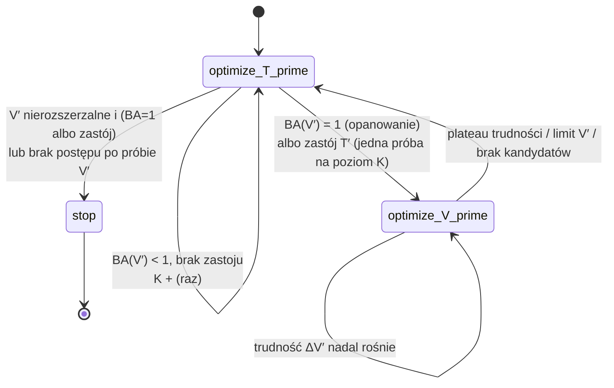

# followup_phase_switch v2: naprzemienna optymalizacja T′ ↔ V′ — implementacja i smoke

Raport generowany przez `scripts/followup_phase_switch/report_v2.py` z tabel w `reports/followup_phase_switch/v2/tables/`.
**To nie jest pełne badanie.** Wykonano testy jednostkowe/integracyjne i krótkie smoke testy (Moons, Szachownica).
Liczba przebiegów: 21, cykli (kroków automatu): 1167. Wyniki v1 (`RAPORT_SMOKE.md`, tabele v1, serie bez prefiksu `v2_`)
i stary tryb `dagasvm_phase` (+ raport `followup_stop_rule`) są nietknięte. Audyt: `AUDYT_v2.md`.

Trudność przyrostu ΔV′ i jakość modelu są **osobnymi właściwościami**; raport nie wnioskuje z jednej o drugiej (trudność ΔV′ jest
sygnałem sterującym fazą V′, a jakość modelu oceniają BA na V′ i — wyłącznie jako obserwacja — pełne V i test).

## 1. Zmienione i nowe pliki

| plik | zmiana |
|---|---|
| `src/ga/phase_switch.py` | tryb `dagasvm_phase_switch`: ustawienia, czyste funkcje decyzyjne, kontroler fazowy, pętla, replay, `CountingModel` (koszt) — poprawiony względem v1 |
| `scripts/run_experiment.py` | `objective_metric_name` = `fitness.tprime_metric` w tym trybie (dispatch trybu istniał w v1) |
| `pyproject.toml` | `[tool.pytest.ini_options] pythonpath` — `./.venv/bin/pytest -q` nie przerywa się już na 2 plikach (brak katalogu głównego w `sys.path`) |
| `tests/test_phase_switch.py` | testy trybu (pkt 14 specyfikacji: `test_req01_*` … `test_req14_*`, koszt, ustawienia) |
| `scripts/followup_phase_switch/{ps_common,aggregate,make_configs,run_queue,report_v2}.py` | wersjonowanie v1/v2; v2 zapisuje do osobnych ścieżek |
| `configs/followup_phase_switch/v2/` | szablony i `study_spec.yaml` v2 |
| `artifacts/followup_phase_switch/v2_*` | przebiegi smoke v2 |
| `reports/followup_phase_switch/AUDYT_v2.md`, `v2/` | audyt, tabele, ten raport |

Niezmienione semantycznie: `src/ga/phase_engine.py`, `src/ga/vprime.py`, `src/ga/loop/engine.py`, `src/ga/models/svm.py` (tryb `dagasvm_phase`).

## 2. Maszyna fazowa

Cykl = jeden krok automatu: **jedno** uruchomienie GA dla T′ (przy stałym K, na pełnym skumulowanym V′) **albo jedno** rozszerzenie V′.
W jednym cyklu K rośnie najwyżej raz, V′ jest rozszerzane najwyżej raz, nigdy oba naraz.

Reguła „minimalny rozmiar V′ + obowiązkowe ponowne sprawdzenie” (odrzucona przez promotora) **nie występuje** w tym trybie: parametry
`daga.min_vprime_per_class` i `daga.perfect_recheck_*` nie są czytane (test `test_rejected_minimum_size_plus_recheck_rule_is_not_used_*`).
Długość fazy V′ wynika wyłącznie z trudności ΔV′, a rozmiar V′ ograniczają limity górne — nie ma żadnego dolnego progu rozmiaru.

### Warunki przejść

| przejście | warunek (wyłącznie V′, ΔV′, T′, K, pula kandydatów; nigdy pełne V ani test) |
|---|---|
| **T′ → V′** (opanowanie) | BA(V′) ≥ `perfect_threshold` (1,0) i V′ można rozszerzyć. K bez zmian. **BA(V′)=1 nie kończy algorytmu.** |
| **T′ → V′** (próba po zastoju) | zastój T′: `max_no_improvement_k_increases` (3) kolejnych zwiększeń K bez poprawy najlepszego fitnessu o ≥ `fitness_min_delta`, albo K nie może rosnąć (limit klasy), albo ρ_SV < TSV (bramka `k_growth_requires_sv_signal`); jednorazowo na poziom K; V′ rozszerzalne. Zapamiętywany jest najlepszy fitness sprzed próby. |
| **K → K+** (T′ → T′) | BA(V′) < 1, brak zastoju, ρ_SV ≥ TSV (z bramką), K może rosnąć. Wielkość kroku: dotychczasowy wzór DAGA na ρ_SV. **Najwyżej raz na cykl; nigdy przy BA(V′)=1; nigdy w fazie V′.** |
| **V′ → V′** | trudność ΔV′ (średnia z okna `vprime_difficulty_window`) wzrosła o ≥ `vprime_difficulty_min_delta` |
| **V′ → T′** | `vprime_difficulty_patience` (2) kolejnych przyrostów bez wzrostu trudności **albo** limit \|V′\| **albo** brak kandydatów **albo** limit rozszerzeń (globalny / w fazie). T′ optymalizowane jest wtedy na pełnym, skumulowanym V′. |
| **po próbie V′** | T′ nie osiągnęło poziomu odniesienia ⇒ K rośnie (raz na cykl) i T′ jest optymalizowane ponownie; dopiero `max_no_improvement_k_increases` takich zwiększeń bez osiągnięcia poziomu, albo K nie może rosnąć ⇒ **stop**. Poziom osiągnięty ⇒ zwykła praca (licznik zastoju od zera). |
| **stop** | patrz niżej |

Trudność przyrostu domyślnie = odsetek błędów modelu T′ (ustalonego na czas fazy V′) na ΔV′ (`vprime_difficulty_metric: error_rate`).
Zapisywane są też: BA(ΔV′), liczba próbek ΔV′ w każdej klasie, zmiana trudności względem poprzedniego przyrostu i koszt.

### Warunek zakończenia całego algorytmu

| kod | warunek |
|---|---|
| `stop_perfect_on_max_vprime` | BA(V′)=1, a V′ nie da się już rozszerzyć (limit rozmiaru, limit liczby rozszerzeń albo brak kandydatów) |
| `stop_no_progress_after_vprime_retry` | po dodatkowej próbie V′ T′ nie osiągnęło poziomu odniesienia także po zwiększeniach K (albo K nie może rosnąć) |
| `stop_tprime_no_progress`, `stop_k_limit`, `stop_no_k_growth_signal` | zastój T′, a próba V′ przy tym K już była lub V′ nierozszerzalne |
| `stop_max_cycles` | bezpiecznik (`max_cycles`) |

Algorytm nie zapętla się: każda faza V′ dodaje ≥ 1 próbkę na klasę (rozmiar ograniczony), K rośnie monotonicznie do limitu klasy,
próba V′ przypada najwyżej raz na poziom K, a nieudana próba kończy algorytm. Dowód empiryczny: tabela 5, test `test_req09_*`.

### Role parametrów

| parametr | rola w v2 |
|---|---|
| **K** (`k_per_class`) | rozmiar T′ (próbek na klasę). Steruje **wyłącznie** rozmiarem T′; nie wpływa na przyrost V′. |
| **ρ_SV** (udział wektorów podpierających w T′) | (i) sygnał diagnostyczny; (ii) wielkość kroku K (wzór DAGA); (iii) przy `k_growth_requires_sv_signal: true` pomocniczy sygnał braku poprawy: ρ_SV < TSV oznacza, że K nie rośnie, i daje zastój T′ (próba V′). Nie powoduje rozszerzenia V′ sam z siebie. |
| **TSV** | próg ρ_SV (domyślnie 0,25). **Nie może samodzielnie powodować wzrostu V′** — V′ rośnie tylko w fazie V′. |
| **Ts** (`daga.Ts`) | cierpliwość wewnątrz GA dla T′ (wczesne zatrzymanie po `Ts` generacjach bez poprawy). Nie steruje fazami ani rozmiarem V′ (w trybie `dagasvm_phase` liczyło też cykle „stabilnego ρ_SV”). |
| `max_no_improvement_k_increases` | liczba kolejnych zwiększeń K bez poprawy fitnessu = zastój T′ |
| `vprime_increment_per_class` | rozmiar przyrostu ΔV′ (niezależny od K) |

## 3. Kontrola rozmiaru V′

Rozmiar V′ zależy tylko od faz i jawnych limitów; nie rośnie z K ani przez sam sygnał ρ_SV. Limit efektywny:
`min(⌊max_vprime_fraction · |V|⌋, max_vprime_rows, |V|)`, plus globalny `max_vprime_expansions` i `max_vprime_expansions_per_phase`.
Rozszerzanie zatrzymuje: plateau trudności ΔV′, limit rozmiaru, limit rozszerzeń albo brak kandydatów (zapisywane w `vprime_limit_reason`).
Test nigdy nie steruje limitem. Dla Szachownicy porównanie przy ≈1000 próbek: `max_vprime_rows: 1000` (serie `v2_smoke_chess_r1000*`).

Wartości domyślne (sekcja `phase_switch`; `fitness.tprime_metric` i `fitness.vprime_metric` = `balanced_accuracy`):

| parametr | wartość |
|---|---|
| vprime_increment_per_class | 10 |
| max_vprime_fraction | 0.25 |
| max_vprime_rows | null |
| max_vprime_expansions | null |
| vprime_difficulty_metric | "error_rate" |
| vprime_difficulty_min_delta | 0.01 |
| vprime_difficulty_patience | 2 |
| vprime_difficulty_window | 2 |
| vprime_min_difficulty | 0.0 |
| max_vprime_expansions_per_phase | 10 |
| max_no_improvement_k_increases | 3 |
| fitness_min_delta | 0.0005 |
| allow_one_vprime_retry_after_t_stall | true |
| retry_resolution | "after_k_increases" |
| retry_reference | "same_vprime" |
| k_growth_requires_sv_signal | true |
| warm_start_tprime | true |
| ga_stop_at_perfect | true |
| representative | "best_on_final_vprime" |
| max_cycles | 300 |

Uzasadnienie (to wartości robocze, **nie strojone**; wrażliwość nie była badana):

| parametr | uzasadnienie |
|---|---|
| `vprime_increment_per_class: 10` | równe `k_start` i V′ startowemu (10/klasę). ΔV′ ma ≥ 20 próbek (2 klasy), więc odsetek błędów ma błąd standardowy rzędu 0,09; mniejszy przyrost zaszumiałby ocenę trudności. Względem \|V\| to 0,07–0,4 % na rozszerzenie. |
| `max_vprime_fraction: 0.25` | górny bezpiecznik, nie cel. Jeden ułamek nie daje porównywalnego \|V′\| (\|V\| od 719 do 27 853), stąd obok `max_vprime_rows`. W smoke nie jest osiągany na Szachownicy ani Moons. |
| `max_vprime_rows: null` | jawny limit tylko tam, gdzie potrzebny (Szachownica: 1000). |
| `max_vprime_expansions: null` | globalny bezpiecznik; domyślnie wyłączony, bo limity rozmiaru i faz wystarczają. |
| `vprime_difficulty_min_delta: 0.01` | wzrost trudności o < 1 p.p. (średnia z okna) traktowany jako brak wzrostu; jedna próbka z 20 to 5 p.p., więc 0,01 jest poniżej rozdzielczości pomiaru. |
| `vprime_difficulty_patience: 2`, `window: 2` | dwa kolejne przyrosty bez wzrostu kończą fazę; okno 2 wygładza fluktuacje Val-GA (stochastyczny). |
| `max_vprime_expansions_per_phase: 10` | bezpiecznik pojedynczej fazy V′. |
| `max_no_improvement_k_increases: 3`, `fitness_min_delta: 0.0005` | wartości ze specyfikacji; 0,0005 = `phase_min_delta` GA, czyli taki sam próg „poprawy” jak wewnątrz GA. |
| `retry_resolution: after_k_increases`, `retry_reference: same_vprime` | patrz `AUDYT_v2.md` §3: T′ dostaje szansę po zwiększeniu K; porównanie na tym samym, rozszerzonym V′ (wariant dosłowny: `literal`). |
| `k_growth_requires_sv_signal: true` | istniejąca polityka K (DAGA). **Do decyzji promotora** (sekcja 9). |
| `warm_start_tprime: true` | ponowna optymalizacja T′ przy tym samym K startuje od poprzedniego najlepszego T′ (bez tego „poprawa względem odniesienia” nie ma sensu). |
| `max_cycles: 300` | bezpiecznik; w smoke maks. liczba cykli = 107. |

## 4. Fitness i BA

`fitness.tprime_metric` i `fitness.vprime_metric` (domyślnie BA) są konfigurowalne; przygotowane pod F1/ROC AUC (nie uruchamiane w tym etapie).
Pełny inwentarz miejsc użycia BA (T′, wybór V′, przełączanie, stop, raportowanie), ciche podstawienia BA w kodzie i ocena metodologiczna: `AUDYT_v2.md` §2.
Test nie jest nigdzie fitnessem ani warunkiem sterującym (testy `test_req10_*`: śmieciowy obserwator pełnego V i odwrócone etykiety testu nie zmieniają trajektorii).

## 5. Testy

`./.venv/bin/pytest -q` → **140 passed, 0 błędów (100 przeszło + 2 błędy kolekcji przed zmianami)**. Wymagania 1–14 ze specyfikacji mają osobne testy (`test_req01_*` … `test_req14_*`; mapa w `AUDYT_v2.md` §4).
Zdolność testów do wykrywania błędów sprawdzono mutacjami: wstrzyknięcie błędu (T′ widzi tylko ostatnie próbki V′, brak limitu rozmiaru, brak limitu
rozszerzeń, BA=1 zwiększa K, pominięty koszt GA) powoduje niepowodzenie odpowiedniego testu. Przebieg v1 odtwarza się bit w bit na kodzie v2 z flagami
`retry_resolution=first_step` i `vprime_difficulty_metric=one_minus_metric` (45 kroków, 60 kolumn).

## 6. Wyniki smoke

Kolumny: \|V′\|, \|V\| i \|V′\|/\|V\| — końcowe; „rozszerzenia V′” — liczba kroków V′; „wejścia do V′” — ile razy faza V′ zaczęła się po opanowaniu V′ (BA=1) /
po zastoju T′ (próba); „BA na V′” — model reprezentatywny (najlepszy na końcowym V′); „BA na ΔV′” — średnia z kroków V′ (model ustalony na czas fazy);
BA test — wyłącznie obserwacja. Pełny SVM (cały zbiór treningowy) ma BA test: chessboard 0,9885, moons 0,9700.

### 6.1. Moons

| seria | zbiór | wariant | n | \|V′\| (śr.) | min–max | \|V\| | \|V′\|/\|V\| | rozszerzenia V′ | cykle (T′/V′) | wejścia do V′ (opanowanie/próba) | K końc. | BA na V′ (model rep.) | BA na ΔV′ (śr. po krokach V′) | BA pełne V (obserwacja) | BA test (obserwacja) | czas [s] | powód zakończenia |
|---|---|---|---|---|---|---|---|---|---|---|---|---|---|---|---|---|---|
| v2_smoke_moons | moons | evo_switch | 3 | 440 | 300–540 | 4800 | 0,092 | 21,0 | 20,7/21,0 | 1,0/3,7 | 87 | 0,8960 | 0,7604 | 0,9673 | 0,9688 ± 0,0022 | 24 | no_k_growth_signal:2, no_progress_after_vprime_retry:1 |
| v2_smoke_moons | moons | rand_replay | 3 | 440 | 300–540 | 4800 | 0,092 | 21,0 | 20,7/21,0 | 1,0/3,7 | 87 | 0,9787 | 0,9623 | 0,9658 | 0,9671 ± 0,0027 | 8 | replay_end:3 |
| v2_smoke_moons | moons | rand_switch | 3 | 247 | 140–320 | 4800 | 0,051 | 11,3 | 16,0/11,3 | 1,0/2,7 | 72 | 0,9819 | 0,9602 | 0,9622 | 0,9640 ± 0,0050 | 7 | no_progress_after_vprime_retry:3 |

### 6.2. Szachownica (limit \|V′\| = 1000; z bramką ρ_SV = wartość domyślna, `_nogate` = bez bramki)

| seria | zbiór | wariant | n | \|V′\| (śr.) | min–max | \|V\| | \|V′\|/\|V\| | rozszerzenia V′ | cykle (T′/V′) | wejścia do V′ (opanowanie/próba) | K końc. | BA na V′ (model rep.) | BA na ΔV′ (śr. po krokach V′) | BA pełne V (obserwacja) | BA test (obserwacja) | czas [s] | powód zakończenia |
|---|---|---|---|---|---|---|---|---|---|---|---|---|---|---|---|---|---|
| v2_smoke_chess_r1000 | chessboard | evo_switch | 2 | 520 | 320–720 | 27853 | 0,019 | 25,0 | 31,5/25,0 | 2,5/3,0 | 892 | 0,9596 | 0,6739 | 0,9680 | 0,9745 ± 0,0056 | 168 | no_k_growth_signal:2 |
| v2_smoke_chess_r1000 | chessboard | rand_replay | 2 | 520 | 320–720 | 27853 | 0,019 | 25,0 | 31,5/25,0 | 2,5/3,0 | 892 | 0,9905 | 0,8966 | 0,9663 | 0,9687 ± 0,0034 | 94 | replay_end:2 |
| v2_smoke_chess_r1000 | chessboard | rand_switch | 2 | 440 | 380–500 | 27853 | 0,016 | 21,0 | 28,5/21,0 | 4,0/2,0 | 817 | 0,9929 | 0,8745 | 0,9624 | 0,9650 ± 0,0030 | 109 | no_progress_after_vprime_retry:2 |
| v2_smoke_chess_r1000_nogate | chessboard | evo_switch | 2 | 870 | 740–1000 | 27853 | 0,031 | 42,5 | 59,5/42,5 | 2,5/6,5 | 5530 | 0,9581 | 0,7332 | 0,9845 | 0,9868 ± 0,0032 | 602 | tprime_no_progress:1, no_progress_after_vprime_retry:1 |
| v2_smoke_chess_r1000_nogate | chessboard | rand_replay | 2 | 870 | 740–1000 | 27853 | 0,031 | 42,5 | 59,5/42,5 | 2,5/6,5 | 5530 | 0,9914 | 0,9337 | 0,9856 | 0,9867 ± 0,0021 | 424 | replay_end:2 |
| v2_smoke_chess_r1000_nogate | chessboard | rand_switch | 2 | 440 | 380–500 | 27853 | 0,016 | 21,0 | 30,0/21,0 | 4,0/2,0 | 818 | 0,9929 | 0,8745 | 0,9624 | 0,9650 ± 0,0030 | 115 | no_progress_after_vprime_retry:2 |

Porównanie sparowane evo_switch − rand_replay (te same seedy i identyczny harmonogram faz, K i \|ΔV′\|; to smoke z n = 2–3, bez wniosków statystycznych):

| series | dataset | metric | n | evo_switch | rand_replay | mean_diff | sd_diff | evo większe | rand większe |
|---|---|---|---|---|---|---|---|---|---|
| v2_smoke_chess_r1000 | chessboard | test_ba | 2 | 0,9745 | 0,9687 | 0,0058 | 0,0090 | 1 | 1 |
| v2_smoke_chess_r1000 | chessboard | fullv_ba | 2 | 0,9680 | 0,9663 | 0,0017 | 0,0063 | 1 | 1 |
| v2_smoke_chess_r1000 | chessboard | vprime_rows | 2 | 520,0000 | 520,0000 | 0,0000 | 0,0000 | 0 | 0 |
| v2_smoke_chess_r1000 | chessboard | steps | 2 | 56,5000 | 56,5000 | 0,0000 | 0,0000 | 0 | 0 |
| v2_smoke_chess_r1000 | chessboard | final_k | 2 | 892,0000 | 892,0000 | 0,0000 | 0,0000 | 0 | 0 |
| v2_smoke_chess_r1000 | chessboard | mean_delta_difficulty | 2 | 0,2740 | 0,1048 | 0,1693 | 0,0010 | 2 | 0 |
| v2_smoke_chess_r1000_nogate | chessboard | test_ba | 2 | 0,9868 | 0,9867 | 0,0001 | 0,0011 | 1 | 1 |
| v2_smoke_chess_r1000_nogate | chessboard | fullv_ba | 2 | 0,9845 | 0,9856 | -0,0011 | 0,0001 | 0 | 2 |
| v2_smoke_chess_r1000_nogate | chessboard | vprime_rows | 2 | 870,0000 | 870,0000 | 0,0000 | 0,0000 | 0 | 0 |
| v2_smoke_chess_r1000_nogate | chessboard | steps | 2 | 102,0000 | 102,0000 | 0,0000 | 0,0000 | 0 | 0 |
| v2_smoke_chess_r1000_nogate | chessboard | final_k | 2 | 5530,0000 | 5530,0000 | 0,0000 | 0,0000 | 0 | 0 |
| v2_smoke_chess_r1000_nogate | chessboard | mean_delta_difficulty | 2 | 0,2269 | 0,0651 | 0,1618 | 0,0049 | 2 | 0 |
| v2_smoke_moons | moons | test_ba | 3 | 0,9688 | 0,9671 | 0,0017 | 0,0040 | 1 | 1 |
| v2_smoke_moons | moons | fullv_ba | 3 | 0,9673 | 0,9658 | 0,0015 | 0,0022 | 2 | 1 |
| v2_smoke_moons | moons | vprime_rows | 3 | 440,0000 | 440,0000 | 0,0000 | 0,0000 | 0 | 0 |
| v2_smoke_moons | moons | steps | 3 | 41,6667 | 41,6667 | 0,0000 | 0,0000 | 0 | 0 |
| v2_smoke_moons | moons | final_k | 3 | 86,6667 | 86,6667 | 0,0000 | 0,0000 | 0 | 0 |
| v2_smoke_moons | moons | mean_delta_difficulty | 3 | 0,2010 | 0,0395 | 0,1615 | 0,0357 | 3 | 0 |

### 6.3. Skąd pochodzą wejścia do fazy V′ (warianty z własnym automatem)

| zbiór | wariant | wejścia do V′ | z opanowania (BA(V′)=1) | z zastoju T′ (próba) | rozmiary V′ przy opanowaniu |
|---|---|---|---|---|---|
| chessboard | evo_switch | 29 | 10 | 19 | 20, 80, 140 |
| chessboard | rand_switch | 24 | 16 | 8 | 20, 100, 140, 160, 220, 260, 320 |
| moons | evo_switch | 14 | 3 | 11 | 20 |
| moons | rand_switch | 11 | 3 | 8 | 20 |

### 6.4. Koszt obliczeń

Wywołania modelu wykonane przez algorytm (obserwacja pełnego V i testu w ostatniej kolumnie, osobno). „Nominalnie” = populacja × (generacje+1) × \|V′\|
bez wcześniejszego zatrzymania GA; „faktycznie” = rzeczywiste ewaluacje GA × \|V′\|. Ewaluacje GA dla T′ to po jednym `predict` na osobnika (zgodność z
rzeczywistą liczbą wywołań `SVC.predict` sprawdza test `test_cost_counters_equal_the_real_number_of_model_calls`). `svm.probability=false` we wszystkich seriach
(przy `true` dodatkowe przejścia `predict_proba` nie są liczone).

| seria | zbiór | wariant | n | treningi SVM | wywołania predict | wywołania decision_function | T′: wiersze V′ ocenione (faktycznie) | T′: nominalnie (bez wcześn. zatrzymania GA) | ΔV′: wiersze ocenione | kandydaci (suma po doborach) | V′: wiersze predict | Val-GA nominalnie [wiersze] | obserwacja [wiersze] |
|---|---|---|---|---|---|---|---|---|---|---|---|---|---|
| v2_smoke_chess_r1000 | chessboard | evo_switch | 2 | 6782 | 6860 | 25 | 1788300 | 8388600 | 500 | 688825 | 689825 | 315000 | 1575693 |
| v2_smoke_chess_r1000 | chessboard | rand_replay | 2 | 5746 | 5796 | 25 | 1443600 | 8388600 | 500 | 688825 | 1000 | 0 | 1575693 |
| v2_smoke_chess_r1000 | chessboard | rand_switch | 2 | 5128 | 5172 | 21 | 1207200 | 6993600 | 420 | 580203 | 840 | 0 | 1425627 |
| v2_smoke_chess_r1000_nogate | chessboard | evo_switch | 2 | 12134 | 12268 | 42 | 5268300 | 25407600 | 850 | 1164842 | 1166542 | 535500 | 2976309 |
| v2_smoke_chess_r1000_nogate | chessboard | rand_replay | 2 | 9944 | 10030 | 42 | 4160700 | 25407600 | 850 | 1164842 | 1700 | 0 | 2976309 |
| v2_smoke_chess_r1000_nogate | chessboard | rand_switch | 2 | 5310 | 5354 | 21 | 1297200 | 7691100 | 420 | 580203 | 840 | 0 | 1500660 |
| v2_smoke_moons | moons | evo_switch | 3 | 3761 | 3827 | 21 | 899400 | 4532200 | 420 | 95920 | 96760 | 264600 | 148800 |
| v2_smoke_moons | moons | rand_replay | 3 | 2771 | 2813 | 21 | 662800 | 4532200 | 420 | 95920 | 840 | 0 | 148800 |
| v2_smoke_moons | moons | rand_switch | 3 | 2156 | 2181 | 11 | 325800 | 2244400 | 227 | 52853 | 453 | 0 | 115200 |

## 7. Kontrola niezmienników na wszystkich zapisanych cyklach

| sprawdzenie | wynik |
|---|---|
| cykle V′ bez poprzedzającej decyzji przełączenia (lub kontynuacji fazy V′) | 0 |
| faza V′ zakończona decyzją „do T′”, a następny cykl nie jest T′ | 0 |
| `prev_phase` niezgodne z poprzednim cyklem | 0 |
| cykle, w których jednocześnie wzrosło K i rozszerzono V′ | 0 |
| zmiana K w cyklu V′ / zmiana V′ w cyklu T′ | 0 / 0 |
| cykl V′, w którym V′ urosło inaczej niż o jedno ΔV′ | 0 |
| BA(V′)=1 i wzrost K w tym samym cyklu (warianty z własnym automatem) | 0 |
| j.w. w `rand_replay` (K narzucone harmonogramem evo; losowe V′ bywa opanowane tam, gdzie ewolucyjne nie) | 8 (informacyjnie) |
| \|V′\| powyżej limitu / `vprime_fraction` ≠ \|V′\|/\|V\| | 0 / 0 |
| więcej niż jedna próba V′ po zastoju przy tym samym K | 0 |
| kontrole po próbie V′ bez osiągnięcia poziomu: dalej zwiększenie K / stop | 23 / 9 (z 32) |
| przebiegi zakończone bezpiecznikiem `stop_max_cycles` | 0 |

## 8. Warunki przed pełnym eksperymentem

| warunek przed pełnym badaniem | stan |
|---|---|
| fazy przełączają się zgodnie z regułą (wejścia do V′ tylko po decyzji przełączenia, powrót do T′ po fazie V′) | spełniony |
| BA(V′)=1,0 nie kończy całego algorytmu (K nie rośnie, przełączenie do V′; stop tylko gdy V′ nie da się rozszerzyć) | spełniony |
| V′ nie rośnie mechanicznie do ≈3500 | spełniony (maks. \|V′\| na Szachownicy = 1000; maks. \|V′\|/\|V\| = 0,113) |
| raportowane jest \|V′\|/\|V\| | spełniony (`vprime_fraction` w cycles.csv, summary.json, per_run.csv) |
| wariant losowy porównywalny przy tym samym rozmiarze V′ | spełniony (7/7 par `rand_replay` ma identyczny końcowy \|V′\|) |
| warunek stopu nie zapętla algorytmu | spełniony (0 stopów bezpiecznikiem `max_cycles`, 0 powtórzonych prób na poziom K) |

## 9. Znane ograniczenia i pytania do promotora

Szczegóły: `AUDYT_v2.md` §5.

1. **Próg „opanowania V′”.** Przy doborze ewolucyjnym BA(V′)=1 zdarza się tylko przy małych V′ (tabela 6.3). Dalsze fazy V′ wynikają z zastoju T′. Czy próg ma być < 1?
2. **Bramka ρ_SV.** Z bramką Szachownica kończy przy K ≈ 900 i BA test poniżej pełnego SVM; bez bramki K rośnie do tysięcy (koszt) i jakość zbliża się do pełnego SVM
   (tabela 6.2). To kompromis rozmiar T′ ↔ jakość ↔ czas, niezależny od reguł V′. Czy zachować bramkę, czy zmienić wzór na ΔK (dziś ma wartość bezwzględną |ρ_SV − TSV|)?
3. **„Co najmniej zapamiętany fitness”.** Domyślnie porównanie na tym samym, rozszerzonym V′; wariant dosłowny zaimplementowany (`retry_reference: literal`), niewybrany.
4. **Model reprezentatywny:** `best_on_final_vprime` vs `last_tprime_step`.
5. **Mała liczba seedów** w smoke (Moons 3, Szachownica 2): brak wniosków o różnicy ewolucja ↔ losowanie.
6. **Skład klasowy ΔV′.** `vprime_increment_per_class` określa łączny rozmiar przyrostu (× liczba klas); skład klasowy wybiera strategia (ewolucja i losowanie
   nie wymuszają równowagi). W smoke udział największej klasy w ΔV′: ewolucja średnio 0,62–0,66 (maks. 0,90), losowanie ≈ 0,58; nigdy przyrost z jednej klasy.
   Odsetek błędów (domyślna miara trudności) zależy od składu przyrostu; BA(ΔV′) i `delta_per_class` są zapisywane obok.
7. **Koszt doboru ewolucyjnego przy dużej puli.** Val-GA ocenia całą pulę kandydatów jednym `predict` na rozszerzenie (zbuforowane predykcje), a stare próbki V′ nie są oceniane.
   Na Moons to taniej niż nominalna ocena podzbiorów (96 tys. wobec 265 tys. wierszy), na Szachownicy (pula ≈ 27 tys.) drożej (≈ 690 tys. wobec 315 tys.). Predykcje „leniwe”
   (tylko wiersze faktycznie użyte przez osobniki) obniżyłyby koszt; nie zaimplementowano, bo wymaga zmiany `vprime.py` współdzielonego ze starym trybem.
8. Przy `svm.probability=true` liczniki kosztu nie obejmują `predict_proba`. Metryki inne niż BA wymagają jeszcze doboru progu „opanowania” (AUDYT_v2 §2).
